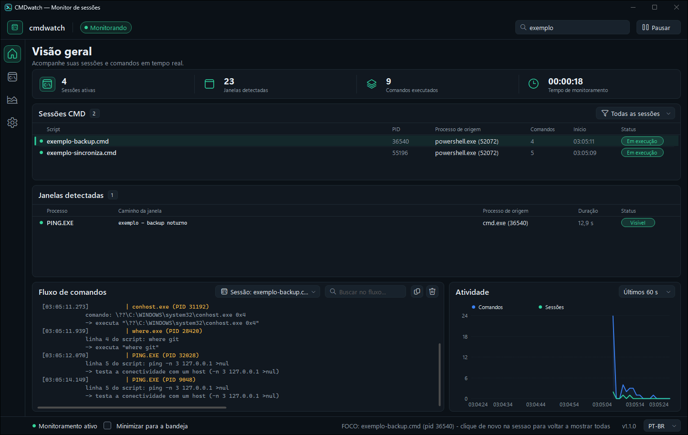
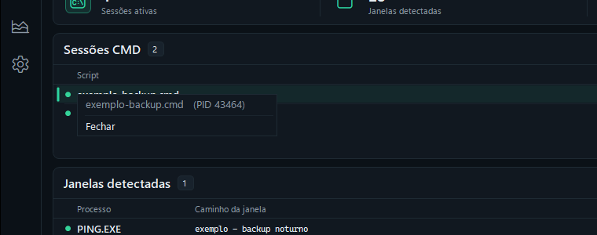
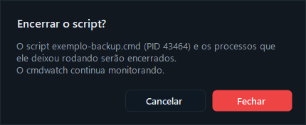

# cmdwatch

**[Português](#português) | [English](#english)**



---

## Português

### Sumário

- [O que é](#o-que-é)
- [Por que existe](#por-que-existe)
- [Download](#download)
- [Como funciona](#como-funciona)
- [Uso: painel gráfico](#uso-painel-gráfico)
- [Uso: linha de comando](#uso-linha-de-comando)
- [Motores de captura](#motores-de-captura)
- [Máscara de segredos](#máscara-de-segredos)
- [Encerrar scripts com segurança](#encerrar-scripts-com-segurança)
- [Saída estruturada (JSONL)](#saída-estruturada-jsonl)
- [Limitações conhecidas](#limitações-conhecidas)
- [Compilando](#compilando)
- [Testes](#testes)
- [Estrutura do projeto](#estrutura-do-projeto)
- [Estendendo](#estendendo)

### O que é

O **cmdwatch** é um monitor de execução de scripts `.cmd`/`.bat` e de janelas de console
para Windows 10/11. Ele responde, em tempo real, a quatro perguntas:

1. **Qual `.cmd` foi aberto?**
2. **Quem chamou?** O processo pai e a cadeia de ancestrais até a raiz.
3. **O que ele está fazendo agora?** Qual comando roda, em qual linha de qual arquivo, e o
   que esse comando significa.
4. **Que janela apareceu na tela, e quem está por trás dela?** O autor, quanto tempo a
   janela ficou aberta e se tomou o foco.

É um executável único (.NET Framework 4.8, sem DLLs nem runtime extra), que funciona
**sem administrador** e **não bloqueia nem altera nada**: só lê o estado do sistema.

### Por que existe

Agentes de IA e ferramentas de automação criam e executam muitos scripts na sua máquina.
Depois de algum tempo, surgem jobs e janelas de CMD abrindo e fechando sozinhos: um
terminal que pisca na tela, uma janela que rouba o foco no meio da digitação, processos
que se acumulam. Isso atrapalha o trabalho, e fica difícil saber **de onde aquilo veio**:
foi o seu agente de IA, outra ferramenta, ou o próprio Windows?

O cmdwatch reúne as evidências para você decidir:

- **quem abriu cada janela** (o autor) e a **cadeia completa de ancestrais**;
- a **linha de comando** de cada processo envolvido;
- os scripts `.cmd`/`.bat` **inclusive os que rodam ocultos**, com cada comando e sua
  explicação, tudo gravado num log.

> O cmdwatch **não classifica automaticamente** "isto é IA" ou "isto é o Windows". Ele
> mostra o autor, a cadeia e a linha de comando; a conclusão é sua, e costuma ser óbvia.

Exemplo: uma janela pisca na tela.

| Cadeia mostrada pelo cmdwatch | Leitura |
|---|---|
| `node.exe` → `python.exe script_pai.py` → `git.exe` | veio do seu agente/ferramenta (o `node` do agente chamou um script Python, que chamou o `git`) |
| `svchost.exe` → `cmd.exe /c higiene-remocao.cmd` | veio de uma **tarefa agendada** do Windows (o Agendador de Tarefas roda dentro de um `svchost.exe`) |

O segundo caso é real: a tarefa agendada `Higiene-Remocao`, que roda como administrador,
abria uma janela e nunca aparecia no log. A versão 1.1.0 passou a capturá-la, com a linha
de comando do `cmd.exe` elevado e o autor (o `python.exe` elevado) atribuídos.

### Download

Executável pronto para Windows 10/11: arquivo único, sem DLLs, precisa só do .NET Framework
4.8 (já presente no sistema).

**[⬇ cmdwatch v1.1.0 — cmdwatch.exe](https://github.com/dellanio/cmdwatch/releases/latest/download/cmdwatch.exe)**

| | |
|---|---|
| Versão | 1.1.0 |
| Página da release | [releases/latest](https://github.com/dellanio/cmdwatch/releases/latest) |

> A release traz o arquivo `cmdwatch.exe.sha256` para conferir o hash. As correções e o
> painel novo descritos aqui estão no código-fonte; compile com `.\build.ps1` para usá-los
> antes da próxima release.

```powershell
cmdwatch.exe            # abre o painel (o mesmo que dar duplo clique)
cmdwatch.exe monitor    # saída no terminal
cmdwatch.exe --help
```

### Como funciona

Todo `.cmd` roda dentro de um `cmd.exe`. O cmdwatch observa a criação de `cmd.exe` cuja
linha de comando referencia um `.cmd`/`.bat` e reconstrói:

- o **processo pai** (explorer.exe, powershell.exe, Code.exe, outro script, um serviço…);
- a **cadeia de ancestrais** até a raiz, com validação do horário de criação contra reuso
  de PID, inclusive de processos que já terminaram (cache recente);
- o **usuário** e a **sessão** do Windows (`sessionId`).

Para cada processo filho do `cmd.exe`, ele:

1. lê a linha de comando real do processo;
2. compara com as linhas de todos os scripts alcançáveis a partir do `.cmd` original
   (inclusive os chamados por `call`, recursivamente);
3. escolhe a melhor correspondência (nome do executável, sufixo de argumentos e
   similaridade);
4. explica o comando em português, com um dicionário de ~125 ferramentas (`npm`, `dotnet`,
   `docker`, `kubectl`, `git`, `robocopy`, `terraform`…) e regras para casos compostos
   (`npm run build`, `git commit -m`, `docker build -t`…).

**`call` roda no mesmo processo.** Quando um `.cmd` faz `call outro.cmd`, o Windows não cria
processo novo, então não há evento para "entrou no build.cmd". O cmdwatch reconstrói a
**árvore de chamadas** lendo os arquivos e procura em qual script o comando observado se
encaixa melhor:

```
release.cmd  ->  call "%~dp0build.cmd"   ->  build.cmd  ->  call npm run build
```

Por isso a saída mostra `em: build.cmd (nivel 1)` e a linha exata dentro do `build.cmd`.

**Janelas.** O cmdwatch observa as janelas que existem na tela (`SetWinEventHook`, eventos
`OBJECT_CREATE`/`SHOW`/`HIDE` e `SYSTEM_FOREGROUND`) e descobre quem está por trás de cada
uma:

| Dado | Como é obtido |
|---|---|
| **Janela** | título e classe da janela |
| **Autor** | quem roda **dentro daquele console**: o ancestral mais próximo dentro do console, sem contar a raiz. Num console `cmd.exe → python.exe → git.exe`, o autor é o `python.exe` (quem chamou), e o `git.exe` fica registrado como o programa em execução |
| **Comando** | a linha de comando do autor |
| **Início / Duração** | quando a janela apareceu e quanto tempo ficou aberta |
| **Foco** | quantas vezes a janela veio para a frente |
| **Estado** | `visível`, `oculta` ou `fechada`. Só é *fechada* quando o Windows confirma que a janela não existe mais; escondida, ela é *oculta*, e ao reaparecer continua a mesma janela |

No **Windows Terminal** existem duas janelas por aba: a `CASCADIA_HOSTING_WINDOW_CLASS`
(título, dono `WindowsTerminal.exe`) e a `PseudoConsoleWindow` (dono = processo real da
sessão). O cmdwatch associa as duas: a Pseudo fica auxiliar (não conta em dobro) e a
Cascadia herda o autor, o comando e a cadeia do processo real. Quando a associação não dá,
o autor vem da árvore de processos do dono e, no painel, da pergunta ao console
(`AttachConsole` + `GetConsoleProcessList`).

Um **console oculto** (o `cmd.exe` com a janela escondida) também gera evento de criação:
ele acorda o motor e dispara uma consulta dirigida ao `cmd.exe` dono da janela.

**Linha de comando de processo elevado.** A leitura principal usa
`NtQueryInformationProcess` classe 60 (`ProcessCommandLineInformation`), que pede apenas
`PROCESS_QUERY_LIMITED_INFORMATION`. Assim a linha de comando de um processo elevado é lida
sem elevar o cmdwatch (medido: 628 processos lidos, 177 falhas, todas em processos
protegidos do SYSTEM). O PEB continua sendo lido só para o diretório de trabalho.

### Uso: painel gráfico

```powershell
cmdwatch.exe            # duplo clique no .exe faz o mesmo
cmdwatch.exe gui        # idêntico, só explícito
```

O executável é uma aplicação Windows (`/target:winexe`): o painel abre sem janela de
console. Os modos de terminal (`monitor`, `analyze`, `trace`) se anexam ao console de quem
os chamou. O painel é WinForms nativo, desenhado à mão em GDI+, sem navegador nem
componentes de terceiros. Aceita as opções do `monitor` (`--filter`, `--interval`,
`--fast-interval`, `--engine`, `--log`, `--quiet`, `--no-windows`, `--no-mask`).

**Áreas do painel**

| Área | O que mostra |
|---|---|
| **Cabeçalho** | estado do monitoramento, busca de sessões e janelas (script, chamador, PID, título, autor) e o botão **Pausar** |
| **Barra lateral** | Visão geral (limpa busca, filtro e seleção), abrir o arquivo de log, intervalo do gráfico (30/60 s) e Configurações (resumo só de leitura: motor, intervalo, observador de janelas, log, filtro) |
| **Indicadores** | sessões ativas, janelas detectadas, comandos executados, tempo de monitoramento |
| **Sessões CMD** | uma linha por script: script, PID, processo de origem, comandos, início e status (*Em execução* / *Encerrada*), com filtro *Todas / Em execução / Encerradas* |
| **Janelas detectadas** | processo autor, título da janela, processo de origem, duração e status (*Visível* / *Oculta* / *Encerrada*) |
| **Fluxo de comandos** | a **mesma saída do `cmdwatch monitor`**, linha a linha, com cores por tipo de evento; seletor de sessão, busca no fluxo, copiar e limpar |
| **Atividade** | comandos e sessões por segundo nos últimos 30 ou 60 s |
| **Rodapé** | estado, *Minimizar para a bandeja*, versão e idioma (PT-BR / EN) |

**Comportamentos**

- **Filtrar por sessão:** clique numa sessão e o fluxo mostra só ela; clique de novo (ou
  `ESC`) para voltar a ver todas.
- **Pausar** (botão ou `ESPAÇO`) pausa **só a exibição**: o motor continua capturando, mas o
  que acontece durante a pausa não entra no painel nem no log do painel.
- `F5` limpa o fluxo. No fluxo, a roda do mouse rola na vertical e `SHIFT`+roda na
  horizontal; as linhas não quebram, como no terminal.
- **Bandeja:** com *Minimizar para a bandeja* marcado, minimizar manda o painel para a área
  de notificação e o monitoramento continua (clique no ícone para restaurar, botão direito
  para sair).
- **Idioma:** a troca PT-BR/EN é imediata e fica salva em `%APPDATA%\cmdwatch\ui.cfg`. As
  explicações dos comandos vêm do dicionário compartilhado com a CLI e continuam em
  português.
- A janela do próprio cmdwatch não entra na lista.

Para ver o painel em ação: `demo\gui-demo.cmd` dispara uma sequência de comandos (inclusive
um `call` de outro `.cmd`).

### Uso: linha de comando

**Monitorar o sistema inteiro**

```powershell
cmdwatch.exe monitor
```

```
[13:50:53.272] >> SESSÃO .CMD ABERTA
           script : C:\projetos\glosa\release.cmd
           origem : Explorer do Windows (abertura por duplo clique ou pelo menu de contexto)
           chamador: explorer.exe (PID 10312)
           cadeia : explorer.exe(10312) -> MiniMax Code.exe(1468)
           resumo : "=== Orquestrador de release ===", publica/implanta artefatos, e chama outros scripts
           passos : 9 comandos mapeados no arquivo

[13:50:53.438]   | node.exe (PID 10648)
             em: build.cmd (nivel 1)
             linha 3 do script: call npm run build
             -> roda o script "build" definido no package.json

[13:50:56.716] ## SESSÃO ENCERRADA  release.cmd  (3,5s, 7 comandos executados)
```

Chamadas entre scripts aparecem com o nível e a linha de onde saíram:

```
[19:54:34.496]   +-> t3-interno.cmd (nivel 2)  (chamado na linha 3 de t2-chama-call.cmd)
```

São reconhecidas as formas `cmd /c script.cmd` (com ou sem aspas, com espaços no caminho e
com argumentos), `cmd /c call`, `cmd /k`, `start "" script.cmd`, `call script.cmd` no mesmo
processo, `.bat`, e abertura por duplo clique no Explorer ou pelo PowerShell. Scripts que já
estavam rodando quando o cmdwatch abriu também aparecem, com o horário real de início, e
caminhos relativos (`cmd /c build.cmd`) são resolvidos pelo diretório de trabalho do
próprio `cmd.exe`.

Eventos de janela entram no mesmo fluxo:

```
[20:50:18.395] .. JANELA ESCONDIDA  C:\Windows\system32\cmd.exe  (13,1s)
[20:50:18.396] ## JANELA FECHADA  C:\Windows\system32\cmd.exe  (13,1s)
```

**Opções**

| Opção | Padrão | Descrição |
|---|---|---|
| `--log <arquivo>` | `cmdwatch-log.jsonl` | log estruturado (JSONL) |
| `--interval <ms>` | `500` | intervalo do motor `polling` com a máquina parada |
| `--fast-interval <ms>` | `50` | intervalo com atividade (nos 10 s seguintes a qualquer evento) |
| `--engine <auto\|polling\|etw\|wmi>` | `auto` | motor de captura |
| `--duration <seg>` | `0` (infinito) | encerra após N segundos |
| `--filter <texto>` | — | só reporta `.cmd` cujo caminho contenha o texto |
| `--no-children` | — | não reporta os comandos internos do script |
| `--no-windows` | — | só scripts: não observa as janelas |
| `--no-mask` | — | não mascara segredos nas linhas de comando |
| `--json` | — | saída JSONL no stdout |
| `--quiet` | — | não grava arquivo de log |
| `--verbose` | — | mostra todo processo detectado (diagnóstico) |

**Explicar um script sem executar**

```powershell
cmdwatch.exe analyze deploy.cmd
```

```
ARQUIVO   : C:\projetos\glosa\deploy.cmd
RESUMO    : "=== Deploy do Portal de Glosa ===", publica/implanta artefatos
CATEGORIA : publicação
PASSOS:
  linha   10  call npm ci
               -> instala as dependências de forma reprodutível a partir do package-lock.json
```

**Executar e capturar a sequência exata**

```powershell
cmdwatch.exe trace deploy.cmd
```

O `trace` cria uma cópia instrumentada do script na mesma pasta (com `echo on`), executa a
cópia e captura o que o `cmd.exe` realmente executou, linha a linha, com horário.
⚠️ Ele **executa o script**: use em ambiente controlado.

### Motores de captura

| Motor | Quando | Como funciona |
|---|---|---|
| `polling` (padrão sem admin) | sempre, **sem administrador** | retrato do sistema via `NtQuerySystemInformation` (7–20 ms por chamada, buffer reaproveitado) e leitura da linha de comando |
| `etw` | com administrador | sessão ETW própria (`CMDWatcher-Processos`, eventos de processo do kernel): o evento de início já traz PID, pai, sessão e linha de comando, então não perde `.cmd` curto |
| `wmi` | com administrador | evento `Win32_ProcessStartTrace` e leitura da linha de comando no processo |

O `auto` usa `etw` quando o cmdwatch roda elevado (e cai para `wmi` se a sessão ETW não
abrir) e `polling` caso contrário. `--engine etw` sem administrador avisa e usa `polling`.
Validado como administrador: 8 de 8 `.cmd` curtos ocultos capturados com linha de comando e
chamador, a ~5,5% de um núcleo.

**Intervalo adaptativo do `polling`:** 50 ms nos 10 s seguintes a qualquer atividade, 500 ms
com a máquina parada. Quando aparece uma janela, o motor acorda na hora com uma consulta
dirigida ao dono da janela.

**Limitação sem administrador** (medida em 03/11/2026, 8 `.cmd` ocultos de ~25 ms, máquina
parada; CPU em % de um núcleo):

| Intervalo parado | Captura | CPU |
|---|---|---|
| 500 ms (padrão) | 0/8 | ~6% com janelas, ~2% com `--no-windows` |
| `--interval 200` | 4/8 | ~5–11% |
| `--interval 100` | 5/8 | ~10–15% |
| `--interval 50` | 4/8 a 8/8 | ~14–17% |

Script oculto que vive menos que o intervalo pode escapar do `polling`. Para capturar
todos, rode como administrador (motor `etw`). Um sensor WMI `__InstanceCreationEvent
WITHIN` (sem admin) foi testado e **removido**: também é polling, chegava sem linha de
comando e custava mais CPU sem capturar mais.

**Custo do painel** (janela visível, % de um núcleo): ~5,7% parado, ~19% em rajada de
atividade.

### Máscara de segredos

Antes de gravar no log ou mostrar no terminal/painel, o cmdwatch troca por `***` o valor de
segredos prováveis nas linhas de comando, nos argumentos do script, nas linhas e nas
explicações do script e no título da janela. A regra é conservadora: só mascara quando o
nome do parâmetro deixa claro que é segredo.

| Padrão | Antes | Depois |
|---|---|---|
| `--password`, `--token`, `--api-key`, `--secret`, `--client-secret`… (com espaço, `=` ou `:`) | `--password <senha>` | `--password ***` |
| `password=`, `pwd=`, `token=`, `apikey=`… (inclusive string de conexão) | `Password=<senha>;` | `Password=***;` |
| `Authorization: Bearer/Basic …` ou `Bearer …` | `Bearer <token>` | `Bearer ***` |
| usuário:senha em URL | `usuário:<senha>@host` | `usuário:***@host` |
| chave de acesso AWS (`AKIA`/`ASIA` + 16) | `AKIA` + 16 caracteres | `AKIA***` |
| `-pSENHA` do `mysql`/`mysqldump`/`mysqladmin`/`mariadb` | `mysql -u root -p<senha>` | `mysql -u root -p***` |

Ficam de fora de propósito: `-p` de outros programas (`ssh -p 22` é porta), senhas
posicionais sem nome e variáveis de ambiente. Para ver as linhas sem máscara (depuração),
use `--no-mask`.

### Encerrar scripts com segurança

**Botão direito numa sessão** em *Sessões CMD* abre o menu com **Fechar**:



O item mostra o alvo (`script (PID)`) e pede confirmação antes de encerrar qualquer coisa:



Ao confirmar:

- o `cmd.exe` que hospeda o script é encerrado **junto com os processos filhos** que ele
  deixou rodando (o `ping.exe`, o `conhost.exe`…);
- antes, o cmdwatch confere se o processo com aquele PID **nasceu na hora registrada**
  quando a sessão foi vista (a conferência é feita no mesmo handle que encerra). Se o PID já
  foi reaproveitado por outro processo, **nada é encerrado** e o painel avisa. Os filhos
  também são conferidos pela hora de início;
- o monitoramento continua: a sessão passa a *Encerrada* e o fluxo registra
  `SESSÃO ENCERRADA`.

Em sessão já encerrada o item fica desativado. Encerrar um processo elevado exige rodar o
cmdwatch como administrador; o painel avisa o motivo se não conseguir.

### Saída estruturada (JSONL)

Uma linha JSON por evento:

```jsonc
{"ts":"2026-10-25T13:50:53.272","type":"batch_open","cmdPid":5400,
 "script":"C:\\projetos\\glosa\\release.cmd","scriptName":"release.cmd",
 "caller":{"pid":10312,"name":"explorer.exe","cmdLine":"C:\\WINDOWS\\Explorer.EXE"},
 "chain":[{"pid":10312,"name":"explorer.exe"}],
 "analysis":{"purpose":"publica/implanta artefatos","category":"publicação","executableSteps":9}}

{"ts":"2026-10-25T13:50:53.438","type":"batch_step","cmdPid":5400,
 "process":{"pid":10648,"ppid":5400,"name":"node.exe","cmdLine":"...npm-cli.js\" run build"},
 "step":{"line":3,"raw":"call npm run build","meaning":"roda o script \"build\" definido no package.json"}}
```

Tipos de sessão: `batch_open`, `batch_step`, `batch_close`, `batch_call`. Tipos de janela:
`window_open`, `window_focus`, `window_hide`, `window_close`, com um bloco `window`:

```jsonc
{"ts":"2026-11-03T20:50:05.120","type":"window_open",
 "window":{"hwnd":"0x1F0A2C","title":"C:\\Windows\\system32\\cmd.exe","class":"ConsoleWindowClass",
           "ownerPid":51740,"owner":"PING.EXE","ownerCmdLine":"ping -n 8 127.0.0.1",
           "authorPid":24284,"author":"cmd.exe","authorCmdLine":"cmd /c \"...\\gui-demo.cmd\"",
           "byConsole":true,"durationMs":13150,"focusCount":0,"visible":true,"closed":false}}
```

`byConsole` diz se o autor foi achado perguntando ao console ou pela árvore / Pseudo.
`chain` lista os ancestrais do autor, inclusive processos já encerrados.

### Limitações conhecidas

- **Scripts `.cmd` ocultos e curtos com a máquina parada** podem escapar do `polling` (ver
  [Motores de captura](#motores-de-captura)). Sem administrador, a captura de scripts
  ocultos mais curtos que o intervalo **não é garantida**; com administrador, use `etw`.
- **Autor no Windows Terminal:** a janela do terminal aparece antes do console da aba, então
  o evento `open` espera até 1,5 s pelo autor real. Com 3 outros consoles abertos, 20
  repetições deram 0 autores errados (`tools\test-d5-repeticao.ps1`). Se a aba não for vista
  nesse prazo, o evento sai com o autor que houver (pode ser o próprio terminal).
- **Linha de comando inacessível** apenas em processos protegidos (SYSTEM). Para processos
  de outro usuário, o evento é registrado sem a linha de comando.
- **A pergunta ao console só funciona no painel.** No modo CLI o cmdwatch já está anexado a
  um console, então o autor vem da árvore de processos / Pseudo.
- **Comandos internos do `cmd.exe`** (`echo`, `cd`, `if`, `for`, `goto`) não criam processo
  e não são observáveis pelo monitor passivo; use o `trace`.
- **`call` atrás de variável** que o cmdwatch não consegue resolver aparece sem o nível
  exato.
- **`cmd.exe` que não é script** (`cmd /c npx …`, servidores de desenvolvimento, MCP) não
  vira sessão, mas a janela dele aparece em *Janelas detectadas*.
- A **pausa** do painel é só de exibição: o que acontece durante a pausa não entra no painel
  nem no log do painel.

### Compilando

```powershell
.\build.ps1
```

O script usa o compilador Roslyn (NuGet `Microsoft.Net.Compilers.Toolset`) e o baixa para
`.build\roslyn` se não existir. O `csc.exe` do .NET Framework é C# 5 e não compila o código.
O `build.ps1` também embute o ícone (`/win32icon` e `/resource`); se `assets\cmdwatch.ico`
não existir, regere com `.\tools\Generate-Icon.ps1`.

Saída: `out\cmdwatch.exe`, um arquivo só, para Windows 10/11 com .NET Framework 4.8.

### Testes

Scripts em `tools\` (PowerShell; abrem só as janelas que o cenário exige e só encerram
processos que eles mesmos iniciaram):

| Script | O que verifica |
|---|---|
| `test-defeitos.ps1` | cadeia de ancestrais (D1), janela escondida (D3), `sessionId` (D4), associação no Windows Terminal (D5 e abas), caminho do ETW, máscara e encerramento seguro por hora de início |
| `test-painel.ps1` | o painel de ponta a ponta: menu *Fechar* com confirmação, PID reaproveitado, autor das janelas e máscara no log do painel; tira as capturas |
| `test-etw.ps1` | motor `etw` como administrador: 8 `.cmd` curtos ocultos |
| `test-bateria.ps1` | as formas de chamar um script |
| `test-cpu-painel.ps1` | CPU do painel parado e em rajada (`-Visivel` para a janela visível) |
| `test-rajada-janelas.ps1` | rajada de janelas (nenhum evento de fechamento perdido) |
| `test-crescimento.ps1` | crescimento de memória em execução longa |
| `captura-readme.ps1` | gera as imagens deste README com scripts de exemplo |

### Estrutura do projeto

```
cmdwatch/
├── src/
│   ├── Core.cs           parser de .cmd, dicionário de explicações, JSON
│   ├── Monitor.cs        motores de captura, atribuição, sessões, árvore de chamadas
│   ├── EtwEngine.cs      motor ETW (administrador)
│   ├── Mascara.cs        máscara de segredos
│   ├── NativeProcess.cs  retrato rápido do sistema e leitura de linha de comando
│   ├── WindowWatcher.cs  observação das janelas (eventos, duração, foco, autor)
│   ├── HumanFormat.cs    formato das mensagens (CLI e painel usam o mesmo)
│   ├── Lang.cs           textos PT-BR/EN e preferência de idioma
│   ├── ConsoleHost.cs    console dos modos de terminal
│   ├── ProcessControl.cs encerramento seguro de processos (e filhos)
│   ├── Program.cs        CLI, saída humana, analyze e trace
│   └── gui/              painel WinForms (Theme, Widgets, DashboardForm, NeonMenu, NeonDialog…)
├── assets/               ícones (gerados por tools\Generate-Icon.ps1)
├── tools/                testes e utilitários
├── demo/                 scripts de demonstração
├── docs/                 imagens e revisão da 1.1.0
└── build.ps1
```

### Estendendo

- **Mais comandos conhecidos:** edite o dicionário `Exe` em `src/Core.cs` (~125 entradas).
- **Regras compostas:** `Explain.Describe` tem blocos por ferramenta (`npm`, `git`, `dotnet`,
  `docker`, `kubectl`, `terraform`…).
- **Explicação por LLM:** o ponto de extensão é `Explain.DescribeObserved`, chamado para todo
  comando não reconhecido.

---

## English

### Contents

- [What it is](#what-it-is)
- [Why it exists](#why-it-exists)
- [Download](#download-1)
- [How it works](#how-it-works)
- [Usage: graphical panel](#usage-graphical-panel)
- [Usage: command line](#usage-command-line)
- [Capture engines](#capture-engines)
- [Secret masking](#secret-masking)
- [Closing scripts safely](#closing-scripts-safely)
- [Structured output (JSONL)](#structured-output-jsonl)
- [Known limitations](#known-limitations)
- [Building](#building)
- [Tests](#tests)
- [Project layout](#project-layout)
- [Extending](#extending)

### What it is

**cmdwatch** monitors `.cmd`/`.bat` scripts and console windows on Windows 10/11. It answers
four questions in real time:

1. **Which `.cmd` was started?**
2. **Who called it?** The parent process and the ancestor chain up to the root.
3. **What is it doing right now?** Which command is running, on which line of which file,
   and what that command means.
4. **Which window appeared on screen, and who is behind it?** The author, how long the
   window stayed open and whether it took focus.

It is a single executable (.NET Framework 4.8, no DLLs, no extra runtime). It works
**without administrator rights** and **never blocks or changes anything**: it only reads
system state.

### Why it exists

AI agents and automation tools create and run lots of scripts on your machine. After a
while, jobs and CMD windows keep opening and closing on their own: a terminal flashes on
screen, a window steals focus while you type, processes pile up. It gets in the way of your
work, and it is hard to tell **where it came from**: your AI agent, another tool, or Windows
itself?

cmdwatch gathers the evidence so you can decide:

- **who opened each window** (the author) and the **full ancestor chain**;
- the **command line** of every process involved;
- `.cmd`/`.bat` scripts, **including hidden ones**, with each command and its explanation,
  all recorded in a log.

> cmdwatch does **not automatically classify** "this is AI" or "this is Windows". It shows
> the author, the chain and the command line; the conclusion is yours, and it is usually
> obvious.

Example: a window flashes on screen.

| Chain shown by cmdwatch | Reading |
|---|---|
| `node.exe` → `python.exe script_pai.py` → `git.exe` | it came from your agent/tool (the agent's `node` started a Python script, which ran `git`) |
| `svchost.exe` → `cmd.exe /c higiene-remocao.cmd` | it came from a Windows **scheduled task** (Task Scheduler runs inside an `svchost.exe`) |

The second case is real: the `Higiene-Remocao` scheduled task, which runs as administrator,
opened a window and never showed up in the log. Version 1.1.0 captures it, with the elevated
`cmd.exe` command line and the author (the elevated `python.exe`) attributed.

### Download

Ready-to-run executable for Windows 10/11: a single file, no DLLs, only needs .NET Framework
4.8 (already part of the system).

**[⬇ cmdwatch v1.1.0 — cmdwatch.exe](https://github.com/dellanio/cmdwatch/releases/latest/download/cmdwatch.exe)**

| | |
|---|---|
| Version | 1.1.0 |
| Release page | [releases/latest](https://github.com/dellanio/cmdwatch/releases/latest) |

> The release includes `cmdwatch.exe.sha256` to check the hash. The fixes and the new panel
> described here are in the source code; build with `.\build.ps1` to use them before the
> next release.

```powershell
cmdwatch.exe            # opens the panel (same as double-clicking)
cmdwatch.exe monitor    # terminal output
cmdwatch.exe --help
```

### How it works

Every `.cmd` runs inside a `cmd.exe`. cmdwatch watches for `cmd.exe` processes whose command
line references a `.cmd`/`.bat` and rebuilds:

- the **parent process** (explorer.exe, powershell.exe, Code.exe, another script, a
  service…);
- the **ancestor chain** up to the root, with creation-time checks against PID reuse,
  including processes that have already exited (recent cache);
- the Windows **user** and **session** (`sessionId`).

For each child process of the `cmd.exe`, it:

1. reads the process's real command line;
2. compares it with the lines of every script reachable from the original `.cmd`
   (including the ones started with `call`, recursively);
3. picks the best match (executable name, argument suffix and similarity);
4. explains the command (in Portuguese) using a dictionary of ~125 tools (`npm`, `dotnet`,
   `docker`, `kubectl`, `git`, `robocopy`, `terraform`…) plus rules for compound cases
   (`npm run build`, `git commit -m`, `docker build -t`…).

**`call` runs in the same process.** When a `.cmd` runs `call other.cmd`, Windows does not
create a new process, so there is no "entered build.cmd" event. cmdwatch rebuilds the
**call tree** by reading the files and looks for the script the observed command fits best:

```
release.cmd  ->  call "%~dp0build.cmd"   ->  build.cmd  ->  call npm run build
```

That is why the output shows `em: build.cmd (nivel 1)` and the exact line inside
`build.cmd`.

**Windows.** cmdwatch watches the windows that exist on screen (`SetWinEventHook`,
`OBJECT_CREATE`/`SHOW`/`HIDE` and `SYSTEM_FOREGROUND` events) and finds out who is behind
each one:

| Field | How it is obtained |
|---|---|
| **Window** | window title and class |
| **Author** | who runs **inside that console**: the closest ancestor inside the console, not counting the root. In a `cmd.exe → python.exe → git.exe` console the author is `python.exe` (the caller), and `git.exe` is recorded as the running program |
| **Command** | the author's command line |
| **Start / Duration** | when the window appeared and how long it stayed open |
| **Focus** | how many times the window came to the front |
| **State** | `visible`, `hidden` or `closed`. A window is only *closed* when Windows confirms it no longer exists; a hidden window is *hidden*, and when it reappears it is still the same window |

In **Windows Terminal** each tab has two windows: `CASCADIA_HOSTING_WINDOW_CLASS` (title,
owned by `WindowsTerminal.exe`) and `PseudoConsoleWindow` (owned by the session's real
process). cmdwatch links them: the Pseudo window is auxiliary (not counted twice) and the
Cascadia window inherits the author, command and chain of the real process. When linking is
not possible, the author comes from the owner's process tree and, in the panel, from asking
the console (`AttachConsole` + `GetConsoleProcessList`).

A **hidden console** (a `cmd.exe` with its window hidden) also raises a creation event: it
wakes the engine and triggers a targeted query for the `cmd.exe` that owns the window.

**Command line of elevated processes.** The main read uses `NtQueryInformationProcess`
class 60 (`ProcessCommandLineInformation`), which only needs
`PROCESS_QUERY_LIMITED_INFORMATION`. The command line of an elevated process is read without
elevating cmdwatch (measured: 628 processes read, 177 failures, all of them protected SYSTEM
processes). The PEB is still read only for the working directory.

### Usage: graphical panel

```powershell
cmdwatch.exe            # double-clicking the .exe does the same
cmdwatch.exe gui        # identical, just explicit
```

The executable is a Windows application (`/target:winexe`): the panel opens without a
console window. The terminal modes (`monitor`, `analyze`, `trace`) attach to the caller's
console. The panel is native WinForms, hand-drawn with GDI+, with no browser and no
third-party components. It accepts the `monitor` options (`--filter`, `--interval`,
`--fast-interval`, `--engine`, `--log`, `--quiet`, `--no-windows`, `--no-mask`).

**Panel areas**

| Area | What it shows |
|---|---|
| **Header** | monitoring state, search over sessions and windows (script, caller, PID, title, author) and the **Pause** button |
| **Sidebar** | Overview (clears search, filter and selection), open the log file, chart range (30/60 s) and Settings (read-only summary: engine, interval, window watcher, log, filter) |
| **Indicators** | active sessions, detected windows, executed commands, monitoring time |
| **CMD sessions** | one row per script: script, PID, parent process, commands, start and status (*Running* / *Ended*), with an *All / Running / Ended* filter |
| **Detected windows** | author process, window title, parent process, duration and status (*Visible* / *Hidden* / *Closed*) |
| **Command flow** | the **same output as `cmdwatch monitor`**, line by line, coloured by event type; session picker, flow search, copy and clear |
| **Activity** | commands and sessions per second over the last 30 or 60 s |
| **Footer** | state, *Minimize to tray*, version and language (PT-BR / EN) |

**Behaviour**

- **Filter by session:** click a session and the flow shows only that session; click again
  (or press `ESC`) to see all of them.
- **Pause** (button or `SPACE`) pauses **the display only**: the engine keeps capturing, but
  what happens during the pause does not reach the panel or the panel's log.
- `F5` clears the flow. In the flow, the mouse wheel scrolls vertically and `SHIFT`+wheel
  horizontally; lines do not wrap, as in the terminal.
- **Tray:** with *Minimize to tray* checked, minimizing sends the panel to the notification
  area and monitoring continues (click the icon to restore, right-click to exit).
- **Language:** switching PT-BR/EN is immediate and saved in `%APPDATA%\cmdwatch\ui.cfg`.
  Command explanations come from the dictionary shared with the CLI and stay in Portuguese.
- cmdwatch's own window is not listed.

To see the panel in action: `demo\gui-demo.cmd` runs a sequence of commands (including a
`call` to another `.cmd`).

### Usage: command line

**Monitor the whole system**

```powershell
cmdwatch.exe monitor
```

```
[13:50:53.272] >> SESSÃO .CMD ABERTA
           script : C:\projetos\glosa\release.cmd
           origem : Explorer do Windows (abertura por duplo clique ou pelo menu de contexto)
           chamador: explorer.exe (PID 10312)
           cadeia : explorer.exe(10312) -> MiniMax Code.exe(1468)
           resumo : "=== Orquestrador de release ===", publica/implanta artefatos, e chama outros scripts
           passos : 9 comandos mapeados no arquivo

[13:50:53.438]   | node.exe (PID 10648)
             em: build.cmd (nivel 1)
             linha 3 do script: call npm run build
             -> roda o script "build" definido no package.json

[13:50:56.716] ## SESSÃO ENCERRADA  release.cmd  (3,5s, 7 comandos executados)
```

(The terminal output is in Portuguese.) Calls between scripts show the level and the line
they came from:

```
[19:54:34.496]   +-> t3-interno.cmd (nivel 2)  (chamado na linha 3 de t2-chama-call.cmd)
```

Recognised forms: `cmd /c script.cmd` (with or without quotes, with spaces in the path and
with arguments), `cmd /c call`, `cmd /k`, `start "" script.cmd`, `call script.cmd` in the
same process, `.bat`, and launching by double-click in Explorer or from PowerShell. Scripts
already running when cmdwatch starts are also shown, with their real start time, and
relative paths (`cmd /c build.cmd`) are resolved against the `cmd.exe`'s own working
directory.

Window events go into the same flow:

```
[20:50:18.395] .. JANELA ESCONDIDA  C:\Windows\system32\cmd.exe  (13,1s)
[20:50:18.396] ## JANELA FECHADA  C:\Windows\system32\cmd.exe  (13,1s)
```

**Options**

| Option | Default | Description |
|---|---|---|
| `--log <file>` | `cmdwatch-log.jsonl` | structured log (JSONL) |
| `--interval <ms>` | `500` | `polling` interval while the machine is idle |
| `--fast-interval <ms>` | `50` | interval during activity (for 10 s after any event) |
| `--engine <auto\|polling\|etw\|wmi>` | `auto` | capture engine |
| `--duration <sec>` | `0` (forever) | stop after N seconds |
| `--filter <text>` | — | only report `.cmd` whose path contains the text |
| `--no-children` | — | do not report the script's inner commands |
| `--no-windows` | — | scripts only: do not watch windows |
| `--no-mask` | — | do not mask secrets in command lines |
| `--json` | — | JSONL output on stdout |
| `--quiet` | — | do not write a log file |
| `--verbose` | — | print every detected process (diagnostics) |

**Explain a script without running it**

```powershell
cmdwatch.exe analyze deploy.cmd
```

**Run a script and capture the exact sequence**

```powershell
cmdwatch.exe trace deploy.cmd
```

`trace` creates an instrumented copy of the script in the same folder (with `echo on`), runs
the copy and captures what `cmd.exe` actually executed, line by line, with timestamps.
⚠️ It **runs the script**: use it in a controlled environment.

### Capture engines

| Engine | When | How it works |
|---|---|---|
| `polling` (default without admin) | always, **no administrator needed** | system snapshot via `NtQuerySystemInformation` (7–20 ms per call, reused buffer) plus command-line reads |
| `etw` | with administrator | its own ETW session (`CMDWatcher-Processos`, kernel process events): the start event already carries PID, parent, session and command line, so short `.cmd` runs are not lost |
| `wmi` | with administrator | `Win32_ProcessStartTrace` event plus reading the command line from the process |

`auto` uses `etw` when cmdwatch runs elevated (falling back to `wmi` if the ETW session
cannot start) and `polling` otherwise. `--engine etw` without administrator warns and uses
`polling`. Validated as administrator: 8 of 8 short hidden `.cmd` runs captured with command
line and caller, at ~5.5% of one core.

**Adaptive `polling` interval:** 50 ms for 10 s after any activity, 500 ms while idle. When a
window appears, the engine wakes up immediately with a targeted query for the window's
owner.

**Limitation without administrator** (measured on 2026-11-03, 8 hidden `.cmd` runs of
~25 ms, idle machine; CPU as % of one core):

| Idle interval | Captured | CPU |
|---|---|---|
| 500 ms (default) | 0/8 | ~6% with windows, ~2% with `--no-windows` |
| `--interval 200` | 4/8 | ~5–11% |
| `--interval 100` | 5/8 | ~10–15% |
| `--interval 50` | 4/8 to 8/8 | ~14–17% |

A hidden script that lives shorter than the interval can slip past `polling`. To capture
all of them, run as administrator (`etw` engine). A WMI `__InstanceCreationEvent WITHIN`
sensor (no admin) was tried and **removed**: it is also polling, arrived without the command
line and cost more CPU without capturing more.

**Panel cost** (visible window, % of one core): ~5.7% idle, ~19% during bursts of activity.

### Secret masking

Before writing to the log or showing anything in the terminal/panel, cmdwatch replaces with
`***` the value of likely secrets in command lines, script arguments, script lines and their
explanations, and window titles. The rule is conservative: it only masks when the parameter
name makes it clear that the value is a secret.

| Pattern | Before | After |
|---|---|---|
| `--password`, `--token`, `--api-key`, `--secret`, `--client-secret`… (with space, `=` or `:`) | `--password <password>` | `--password ***` |
| `password=`, `pwd=`, `token=`, `apikey=`… (including connection strings) | `Password=<senha>;` | `Password=***;` |
| `Authorization: Bearer/Basic …` or `Bearer …` | `Bearer <token>` | `Bearer ***` |
| user:password in a URL | `user:<password>@host` | `user:***@host` |
| AWS access key (`AKIA`/`ASIA` + 16) | `AKIA` + 16 characters | `AKIA***` |
| `-pPASSWORD` for `mysql`/`mysqldump`/`mysqladmin`/`mariadb` | `mysql -u root -p<senha>` | `mysql -u root -p***` |

Deliberately left out: `-p` for other programs (`ssh -p 22` is a port), unnamed positional
passwords and environment variables. To see raw lines (debugging), use `--no-mask`.

### Closing scripts safely

**Right-click a session** in *CMD sessions* to open the menu with **Close** (*Fechar*):


The item shows the target (`script (PID)`) and asks for confirmation before closing
anything:


On confirmation:

- the `cmd.exe` hosting the script is closed **together with the child processes** it left
  running (`ping.exe`, `conhost.exe`…);
- first, cmdwatch checks that the process with that PID **was created at the time recorded**
  when the session was seen (the check uses the same handle that terminates it). If the PID
  has been reused by another process, **nothing is closed** and the panel says so. Child
  processes are also checked by start time;
- monitoring continues: the session becomes *Ended* and the flow records
  `SESSÃO ENCERRADA`.

For a session that has already ended, the item is disabled. Closing an elevated process
requires running cmdwatch as administrator; the panel explains why if it cannot.

### Structured output (JSONL)

One JSON line per event:

```jsonc
{"ts":"2026-10-25T13:50:53.272","type":"batch_open","cmdPid":5400,
 "script":"C:\\projetos\\glosa\\release.cmd","scriptName":"release.cmd",
 "caller":{"pid":10312,"name":"explorer.exe","cmdLine":"C:\\WINDOWS\\Explorer.EXE"},
 "chain":[{"pid":10312,"name":"explorer.exe"}],
 "analysis":{"purpose":"publica/implanta artefatos","category":"publicação","executableSteps":9}}
```

Session types: `batch_open`, `batch_step`, `batch_close`, `batch_call`. Window types:
`window_open`, `window_focus`, `window_hide`, `window_close`, with a `window` block (`hwnd`,
`title`, `class`, `owner*`, `author*`, `byConsole`, `durationMs`, `focusCount`, `visible`,
`closed`). `byConsole` tells whether the author was found by asking the console or from the
tree / Pseudo window. `chain` lists the author's ancestors, including processes that have
already exited.

### Known limitations

- **Short hidden `.cmd` scripts on an idle machine** can slip past `polling` (see
  [Capture engines](#capture-engines)). Without administrator, capturing hidden scripts
  shorter than the interval is **not guaranteed**; with administrator, use `etw`.
- **Author in Windows Terminal:** the terminal window shows up before the tab's console, so
  the `open` event waits up to 1.5 s for the real author. With 3 other consoles open, 20
  repetitions gave 0 wrong authors (`tools\test-d5-repeticao.ps1`). If the tab is not seen
  within that time, the event goes out with whatever author is known (it may be the terminal).
- **Command line unavailable** only for protected (SYSTEM) processes. For other users'
  processes the event is recorded without the command line.
- **Asking the console only works in the panel.** In CLI mode cmdwatch is already attached
  to a console, so the author comes from the process tree / Pseudo window.
- **`cmd.exe` built-ins** (`echo`, `cd`, `if`, `for`, `goto`) do not create processes and
  cannot be seen by the passive monitor; use `trace`.
- **`call` behind a variable** that cmdwatch cannot resolve is shown without the exact level.
- **A `cmd.exe` that is not a script** (`cmd /c npx …`, dev servers, MCP) does not become a
  session, but its window appears in *Detected windows*.
- The panel's **pause** is display-only: what happens during the pause does not reach the
  panel or the panel's log.

### Building

```powershell
.\build.ps1
```

The script uses the Roslyn compiler (NuGet `Microsoft.Net.Compilers.Toolset`) and downloads
it to `.build\roslyn` if missing. The .NET Framework `csc.exe` is C# 5 and cannot compile
the code. `build.ps1` also embeds the icon (`/win32icon` and `/resource`); if
`assets\cmdwatch.ico` is missing, regenerate it with `.\tools\Generate-Icon.ps1`.

Output: `out\cmdwatch.exe`, a single file, for Windows 10/11 with .NET Framework 4.8.

### Tests

Scripts in `tools\` (PowerShell; they only open the windows a scenario needs and only close
processes they started themselves):

| Script | What it checks |
|---|---|
| `test-defeitos.ps1` | ancestor chain (D1), hidden window (D3), `sessionId` (D4), Windows Terminal linking (D5 and tabs), ETW path, masking and safe close by start time |
| `test-painel.ps1` | the panel end to end: *Close* menu with confirmation, reused PID, window authors and masking in the panel log; takes the screenshots |
| `test-etw.ps1` | `etw` engine as administrator: 8 short hidden `.cmd` runs |
| `test-bateria.ps1` | the ways of calling a script |
| `test-cpu-painel.ps1` | panel CPU idle and in bursts (`-Visivel` for a visible window) |
| `test-rajada-janelas.ps1` | burst of windows (no close event lost) |
| `test-crescimento.ps1` | memory growth over a long run |
| `captura-readme.ps1` | generates this README's images with sample scripts |

### Project layout

```
cmdwatch/
├── src/
│   ├── Core.cs           .cmd parser, explanation dictionary, JSON
│   ├── Monitor.cs        capture engines, attribution, sessions, call tree
│   ├── EtwEngine.cs      ETW engine (administrator)
│   ├── Mascara.cs        secret masking
│   ├── NativeProcess.cs  fast system snapshot and command-line reads
│   ├── WindowWatcher.cs  window watching (events, duration, focus, author)
│   ├── HumanFormat.cs    message format (shared by CLI and panel)
│   ├── Lang.cs           PT-BR/EN strings and language preference
│   ├── ConsoleHost.cs    console for the terminal modes
│   ├── ProcessControl.cs safe process termination (with children)
│   ├── Program.cs        CLI, human output, analyze and trace
│   └── gui/              WinForms panel (Theme, Widgets, DashboardForm, NeonMenu, NeonDialog…)
├── assets/               icons (generated by tools\Generate-Icon.ps1)
├── tools/                tests and utilities
├── demo/                 demo scripts
├── docs/                 images and the 1.1.0 review
└── build.ps1
```

### Extending

- **More known commands:** edit the `Exe` dictionary in `src/Core.cs` (~125 entries).
- **Compound rules:** `Explain.Describe` has blocks per tool (`npm`, `git`, `dotnet`,
  `docker`, `kubectl`, `terraform`…).
- **LLM explanations:** the extension point is `Explain.DescribeObserved`, called for every
  unrecognised command.
