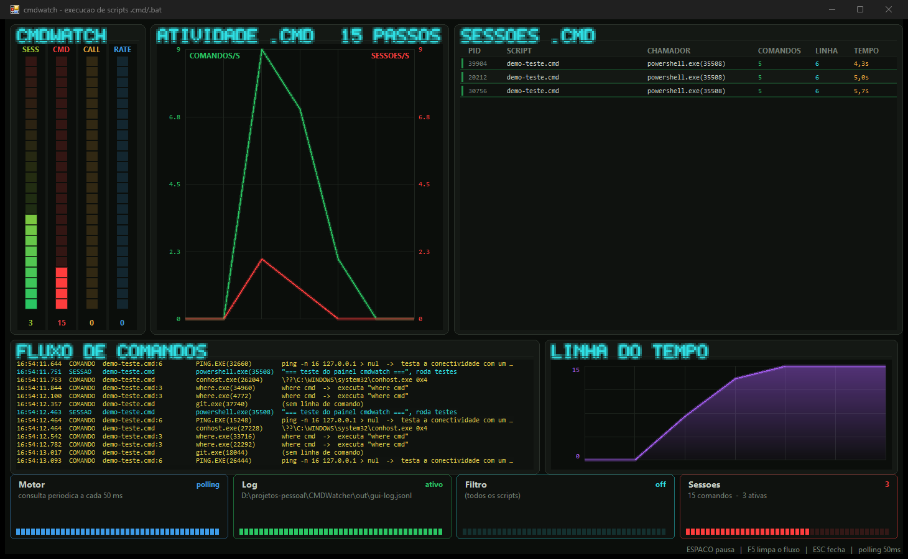

# cmdwatch

Monitor de execução de scripts `.cmd`/`.bat` para Windows. Responde a três perguntas,
em tempo real:

1. **Qual `.cmd` foi aberto?**
2. **Quem chamou** (processo pai, com a cadeia de ancestrais até a raiz).
3. **O que ele está fazendo agora** — qual comando está sendo executado, em qual linha
   de qual arquivo, e o que esse comando significa.

```
[13:50:53.272] >> SESSÃO .CMD ABERTA
           script : C:\projetos\glosa\release.cmd
           origem : Explorer do Windows (abertura por duplo clique ou pelo menu de contexto)
           chamador: explorer.exe (PID 10312)
           cadeia : explorer.exe(10312) -> MiniMax Code.exe(1468)
           resumo : "=== Orquestrador de release ===", publica/implanta artefatos, e chama outros scripts
           passos : 9 comandos mapeados no arquivo

[13:50:53.438]   | node.exe (PID 10648)
             em: build.cmd (nivel 1)
             linha 3 do script: call npm run build
             -> roda o script "build" definido no package.json

[13:50:54.116]   | node.exe (PID 16944)
             em: deploy.cmd (nivel 1)
             linha 10 do script: call npm ci
             -> instala as dependências de forma reprodutível a partir do package-lock.json

[13:50:56.716] ## SESSÃO ENCERRADA  release.cmd  (3,5s, 7 comandos executados)
```

---

## Painel gráfico (Windows)

O mesmo motor, agora com uma interface ao vivo para acompanhar a execução dos scripts:



```powershell
cmdwatch.exe gui
```

O painel é **WinForms nativo dentro do mesmo executável** — sem runtime extra, sem navegador,
sem Electron. Aceita as mesmas opções do `monitor` (`--filter`, `--interval`, `--engine`,
`--log`, `--quiet`).

| Painel | O que mostra |
|---|---|
| **CMDWATCH** (medidores) | sessões ativas, comandos observados, chamadas encadeadas e eventos/segundo |
| **ATIVIDADE .CMD** | comandos/s (verde) e sessões abertas/s (vermelho) nos últimos 60 s |
| **SESSÕES .CMD** | cada `.cmd` vivo: PID, script, quem chamou, comandos, última linha e tempo de vida |
| **FLUXO DE COMANDOS** | o stream de eventos, com a explicação de cada comando em português |
| **LINHA DO TEMPO** | total acumulado de comandos observados |
| **Motor / Log / Filtro / Sessões** | estado do motor de captura, arquivo de log, filtro e totais |

Atalhos: `ESPAÇO` pausa, `F5` limpa o fluxo, `ESC` fecha.

> A interface é desenhada à mão em GDI+ (painéis arredondados, gráficos com halo neon e
> títulos em fonte de matriz 5×7), sem nenhum controle de terceiros.

---

## Existe software pronto pra isso?

Sim, existem ferramentas **genéricas** de monitoramento de processo, mas nenhuma entrega
a parte "explicar o que o .cmd está fazendo":

| Ferramenta | O que faz | Limitação pro nosso caso |
|---|---|---|
| **Sysinternals Process Monitor** | Captura criação de processo, linha de comando e árvore de processos em tempo real | Exige admin; não sabe nada sobre `.cmd`; você tem que filtrar e interpretar manualmente |
| **Sysmon (Event ID 1)** | Mesmo, via Event Log, com `ParentCommandLine` | Idem; é telemetria genérica de segurança |
| **Event Log 4688** | Criação de processo auditada pelo Windows | Precisa habilitar "Audit Process Creation"; e **não** mostra qual linha do `.cmd` está rodando |
| **WMI `Win32_ProcessStartTrace`** | Evento de criação de processo via WMI | Exige admin; **não** traz a linha de comando (precisa de segunda consulta) |
| **ETW `Microsoft-Windows-Kernel-Process`** | Precisão de Event Tracing: não perde processo nenhum | Exige admin em Windows 11 |

Ou seja: as ferramentas existentes dão **o processo e a linha de comando**, mas o "que comando do
`.cmd` está rodando" e o "o que isso significa" ficam por conta do humano. **O `cmdwatch`
fecha essa lacuna** — e ainda roda **sem precisar de administrador**.

---

## Como funciona

O `cmdwatch` é um executável único (.NET Framework 4.8, **zero dependências**),
compilado a partir de C# em `src/`.

### Motor de captura

| Motor | Quando usar | Como funciona |
|---|---|---|
| `polling` (padrão) | Sempre, **sem admin** | `CreateToolhelp32Snapshot` (~8 ms por varredura) + leitura do *command line* direto do PEB do processo |
| `wmi` | Com admin | Evento `Win32_ProcessStartTrace` (detecção instantânea) + WMI para a linha de comando |

O `auto` escolhe `wmi` quando o processo roda elevado e `polling` caso contrário.

Por que não WMI em tudo: uma consulta a `Win32_Process` no WMI leva **170–300 ms** nesta
máquina — scripts `.cmd` curtos terminariam antes de serem vistos. A enumeração via
Toolhelp + PEB leva ~8 ms e pega inclusive processos que viveram menos de 50 ms.

> A leitura do *command line* pelo PEB não usa offsets fixos de `RTL_USER_PROCESS_PARAMETERS`
> (que mudam entre versões do Windows): o código varre a região procurando a `UNICODE_STRING`
> cujo conteúdo começa com o executável do processo.

### Atribuição: quem chamou

Todo `.cmd` roda dentro de um `cmd.exe`. O `cmdwatch` monitora a criação de `cmd.exe`
cuja linha de comando referencia um `.cmd`/`.bat` e reconstrói:

* o **processo pai** (explorer.exe, powershell.exe, Code.exe, outro script, serviço…),
* a **cadeia de ancestrais** até a raiz (até 6 níveis),
* o **usuário** e a sessão do Windows.

### Explicação: o que está rodando

Para cada processo filho do `cmd.exe`, o `cmdwatch`:

1. Lê o *command line* real do processo.
2. Compara com as linhas de todos os scripts alcançáveis a partir do `.cmd` original
   (incluindo os chamados por `call`, recursivamente).
3. Escolhe a melhor combinação (nome do executável + sufixo de argumentos + similaridade).
4. Explica o comando em português, com um dicionário de ~125 ferramentas
   (`npm`, `dotnet`, `docker`, `kubectl`, `git`, `robocopy`, `terraform`, …) e regras
   específicas para os casos compostos (`npm run build`, `git commit -m`, `docker build -t`…).

#### Detalhe importante: `call` roda no mesmo processo

Quando um `.cmd` faz `call outro.cmd`, o Windows **não cria um processo novo** — o script
chamado roda dentro do mesmo `cmd.exe`. Por isso não existe evento observável para
"entrou no build.cmd". O `cmdwatch` resolve isso reconstruindo a **árvore de chamadas**
a partir do conteúdo dos arquivos e procurando em qual script o comando observado
melhor se encaixa:

```
release.cmd  ->  call "%~dp0build.cmd"   ->  build.cmd  ->  call npm run build
```

Por isso a saída mostra `em: build.cmd (nivel 1)` e a linha exata dentro do `build.cmd`.

---

## Uso

### Monitorar o sistema inteiro

```powershell
cmdwatch.exe monitor
```

Opções:

| Opção | Padrão | Descrição |
|---|---|---|
| `--log <arquivo>` | `cmdwatch-log.jsonl` | Log estruturado (JSONL) |
| `--interval <ms>` | `50` | Intervalo de amostragem do motor `polling` |
| `--engine <auto\|polling\|wmi>` | `auto` | Motor de captura |
| `--duration <seg>` | `0` (infinito) | Encerra após N segundos |
| `--filter <texto>` | — | Só reporta `.cmd` cujo caminho contenha o texto |
| `--no-children` | — | Não reporta os comandos internos do script |
| `--json` | — | Saída JSONL no stdout |
| `--quiet` | — | Não escreve arquivo de log |
| `--verbose` | — | Despeja todo processo detectado (diagnóstico) |

### Painel gráfico

```powershell
cmdwatch.exe gui
```

Painel ao vivo do fluxo de execução de scripts — veja [Painel gráfico](#painel-gráfico-windows).

### Explicar um script (sem executar)

```powershell
cmdwatch.exe analyze deploy.cmd
```

```
ARQUIVO   : C:\projetos\glosa\deploy.cmd
RESUMO    : "=== Deploy do Portal de Glosa ===", publica/implanta artefatos
CATEGORIA : publicação
TAMANHO   : 23 linhas, 15 passos executáveis
VARIÁVEIS : PATH, NODE_ENV

PASSOS:
  linha    1  @echo off
               -> exibe uma mensagem na tela
  linha   10  call npm ci
               -> instala as dependências de forma reprodutível a partir do package-lock.json
  ...
```

### Executar e capturar a sequência exata de comandos

```powershell
cmdwatch.exe trace deploy.cmd
```

```
[0,00s] echo === Deploy do Portal de Glosa ===
          -> exibe uma mensagem na tela   [echo ← linha 3]
[0,04s] call npm ci
          -> instala as dependências de forma reprodutível a partir do package-lock.json   [npm ← linha 10]
[2,31s] dotnet publish src\Api\Api.csproj -c Release -o dist\api
          -> compila e publica o projeto .NET para o diretório de saída   [dotnet ← linha 16]
```

O `trace` cria uma **cópia instrumentada** do script na mesma pasta (com `echo on` no lugar
de `echo off`), executa a cópia e captura o que o `cmd.exe` realmente executou, linha a
linha, com timestamp. ⚠️ Ele **executa o script** — use em ambiente controlado.

---

## Saída estruturada (JSONL)

Uma linha JSON por evento:

```jsonc
{"ts":"2026-10-25T13:50:53.272","type":"batch_open","cmdPid":5400,
 "script":"C:\\projetos\\glosa\\release.cmd","scriptName":"release.cmd",
 "caller":{"pid":10312,"name":"explorer.exe","cmdLine":"C:\\WINDOWS\\Explorer.EXE",
           "description":"Explorer do Windows (abertura por duplo clique...)"},
 "chain":[{"pid":10312,"name":"explorer.exe"}],
 "analysis":{"purpose":"publica/implanta artefatos","category":"publicação","executableSteps":9}}

{"ts":"2026-10-25T13:50:53.438","type":"batch_step","cmdPid":5400,
 "process":{"pid":10648,"ppid":5400,"name":"node.exe","cmdLine":"...npm-cli.js\" run build"},
 "step":{"line":3,"raw":"call npm run build","meaning":"roda o script \"build\" definido no package.json"}}

{"ts":"2026-10-25T13:50:56.716","type":"batch_close","cmdPid":5400,"durationMs":3444,"stepCount":7}
```

Tipos: `batch_open`, `batch_step`, `batch_call`, `batch_close`.

---

## Limitações conhecidas

* **Processos que duram menos de ~50 ms** podem escapar do motor `polling`. Com admin,
  use `--engine wmi` para não perder nenhum.
* **Linha de comando inacessível** em processos de outro usuário ou elevados — o evento é
  registrado, mas sem a linha de comando (o `cmdwatch` não tem permissão para ler o PEB alheio).
* **Comandos internos do `cmd.exe`** (`echo`, `cd`, `if`, `for`, `goto`) não geram processo
  filho, então não são observáveis pelo monitor passivo. Para ver a sequência completa de
  um script específico, use o modo `trace`.
* O `cmdwatch` **não bloqueia nem altera** nada: é somente leitura de estado do sistema.

---

## Compilando

```powershell
.\build.ps1
```

O script usa o compilador Roslyn (NuGet `Microsoft.Net.Compilers.Toolset`). Se ele não
estiver em `.build\roslyn`, o `build.ps1` baixa automaticamente — ou use o
`csc.exe` do .NET Framework:

```powershell
& "C:\Windows\Microsoft.NET\Framework64\v4.0.30319\csc.exe" /target:exe /out:out\cmdwatch.exe `
  /r:System.Management.dll /r:System.Drawing.dll /r:System.Windows.Forms.dll `
  src\Core.cs src\Monitor.cs src\NativeProcess.cs src\Program.cs src\gui\*.cs
```

⚠️ O `csc.exe` do framework é o compilador **C# 5**; o código usa recursos mais novos.
Use o Roslyn (o `build.ps1` resolve isso).

Saída: `out/cmdwatch.exe` — um arquivo, sem DLLs, sem runtime extra. Roda em qualquer
Windows 10/11 com .NET Framework 4.8 (já presente no sistema).

## Estrutura

```
cmdwatch/
├── src/
│   ├── Core.cs          parser de .cmd, dicionário de explicações, JSON
│   ├── Monitor.cs       engines de captura, atribuição, sessões, árvore de chamadas
│   ├── NativeProcess.cs Toolhelp + leitura de PEB
│   ├── Program.cs       CLI, saída humana, modos analyze e trace
│   └── gui/             painel WinForms (dashboard ao vivo)
│       ├── Theme.cs         paleta + fonte de matriz 5×7 (títulos em LED)
│       ├── Widgets.cs       medidores, gráficos, tabela e painéis mini
│       ├── DashboardForm.cs layout, estado e consumo dos eventos
│       └── GuiRunner.cs     entrada da GUI e modo escuro da barra de título
├── demo/                scripts de demonstração
├── docs/dashboard.png   captura do painel
├── build.ps1
└── out/cmdwatch.exe     <- o executável (arquivo único, sem DLLs)
```

## Estendendo

* **Mais comandos conhecidos**: edite o dicionário `Exe` em `src/Core.cs` (~125 entradas).
* **Regras compostas**: o método `Explain.Describe` tem blocos por ferramenta
  (`npm`, `git`, `dotnet`, `docker`, `kubectl`, `terraform`, …).
* **Explicação por LLM**: o ponto de extensão natural é `Explain.DescribeObserved`, que é
  chamado para todo comando não reconhecido. Ele pode ser trocado por uma chamada a um
  modelo (o runtime local já expõe um endpoint compatível com a API da Anthropic em
  `~/.minimax/config.yaml`).
