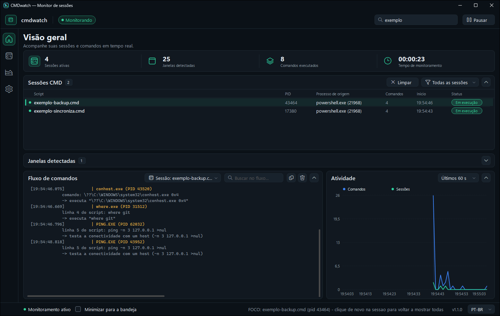
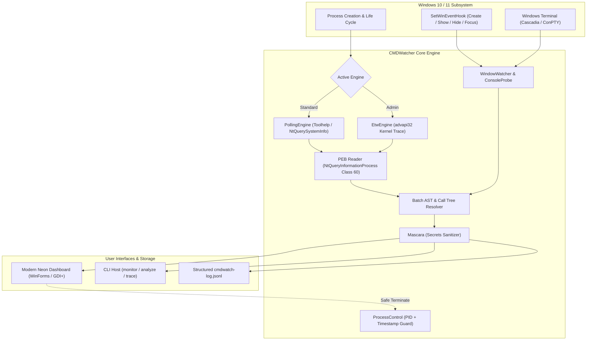

<div align="center">

# ⚡ CMDWatcher (cmdwatch)

**Real-time execution monitor & window author tracer for `.cmd`/`.bat` scripts and background processes on Windows 10/11**

[](https://microsoft.com/windows)
[-512BD4.svg?style=flat&logo=dotnet)](https://dotnet.microsoft.com)
[](https://docs.microsoft.com/dotnet/csharp/)
[%20%7C%20Portable-success.svg?style=flat)](https://github.com/dellanio/cmdwatch/releases)
[](https://github.com/dellanio/cmdwatch)
[](LICENSE)

*Track popping console windows, identify the exact root-cause process behind every terminal, and monitor AI agent automation scripts in real time.*

[Português (README.pt-BR.md)](README.pt-BR.md)

</div>

---

## 📸 Screenshots & UI

<div align="center">
  <table>
    <tr>
      <td align="center"><b>Modern Real-Time Neon Dashboard (Dark Theme)</b></td>
      <td align="center"><b>Safe Process Termination with PID Guard</b></td>
    </tr>
    <tr>
      <td align="center">
        
      </td>
      <td align="center">
        
      </td>
    </tr>
    <tr>
      <td align="center"><b>Right-Click Context Actions on Windows & Sessions</b></td>
      <td align="center"><b>Collapsible Panels & Adaptive Layout</b></td>
    </tr>
    <tr>
      <td align="center">
        
      </td>
      <td align="center">
        
      </td>
    </tr>
  </table>
</div>

---

## ⚡ The Problem

With the widespread adoption of **autonomous AI agents, background automation scripts, and build tools**, developers' workstations run dozens of unmonitored scripts. Over time:
- Random CMD windows flash on screen, stealing focus in the middle of typing;
- Hidden background batch files consume CPU and memory undetected;
- Standard Task Manager only lists generic `cmd.exe` processes without showing **who called them** (was it an AI agent, an IDE extension, a Windows scheduled task, or malware?).

---

## 💡 The Solution: CMDWatcher

**CMDWatcher** (`cmdwatch`) is a lightweight, zero-dependency utility for Windows 10/11 designed to answer four critical questions in real time:

1. **Which `.cmd`/`.bat` script was executed?** Exact script path and full command-line arguments.
2. **Who started it?** Complete ancestor chain (parent, grandparent... all the way to root).
3. **What is it doing right now?** The exact command executing at this moment (even across nested `call` chains), translated into human-readable explanation.
4. **Which window appeared on screen, and who is behind it?** The true author process, duration on screen, focus count, and visibility state.

> **Neutral Evidence:** cmdwatch does not make arbitrary guesses or label processes as "AI" or "system". It delivers **concrete, timestamped forensic proof** so you can make informed decisions.

| Ancestor Chain Shown by cmdwatch | Real-World Context |
|---|---|
| `node.exe` → `python.exe script_pai.py` → `git.exe` | Launched by your AI agent / Node.js development tool |
| `svchost.exe` → `cmd.exe /c cleanup.cmd` | Triggered by a Windows **Scheduled Task** |

---

## 🚀 Key Features

- 📦 **Single Portable Executable:** ~580 KB compiled with C# (.NET Framework 4.8, already pre-installed on Windows). Zero installer, zero external DLLs.
- 🛡️ **No Administrator Rights Required:** Inspects processes, parameters, and PEB memory (`NtQueryInformationProcess`) without requiring elevation.
- 🔍 **Accurate Console Author Resolution (ConPTY / Cascadia):** In Windows Terminal, seamlessly correlates `CASCADIA_HOSTING_WINDOW_CLASS` host windows with their underlying `PseudoConsoleWindow`, identifying the real author rather than `WindowsTerminal.exe`.
- ⚡ **Dual Capture Engines (Polling & Kernel ETW):**
  - *Standard Mode:* High-speed adaptive polling using Toolhelp32 snapshots and `SystemProcessInformation`.
  - *ETW Kernel Mode (with Admin):* Intercepts kernel trace events in real time without missing short-lived scripts (< 25 ms).
- 🔒 **Active Secret Masking:** Automatically redacts tokens, passwords, API keys, `Authorization: Bearer` headers, and AWS credentials before saving to logs or rendering on screen.
- 🛑 **Safe Process Tree Termination (PID Reuse Guard):** Safely terminates runaway scripts and child process trees directly from the UI, with strict creation timestamp verification (`GetProcessTimes`) preventing accidental termination of recycled PIDs.
- 🎨 **Custom Neon UI:** Lightweight GDI+ rendering with Dark and Light themes, real-time search, sortable columns, and background minimization to the Windows System Tray.

---

## 🏗️ Architecture & Data Flow



- **Language:** C# (.NET Framework 4.8)
- **UI Toolkit:** Pure Windows Forms with custom GDI+ drawing (Dark / Light)
- **Native APIs:** `kernel32.dll`, `user32.dll`, `ntdll.dll` (`NtQueryInformationProcess`), `advapi32.dll` (ETW)
- **Build System:** Self-bootstrapping PowerShell script (`build.ps1`) using Roslyn compiler

---

## 📦 Download & Getting Started

Download the pre-compiled binary:

**[⬇ Download cmdwatch v1.1.0 — cmdwatch.exe](https://github.com/dellanio/cmdwatch/releases/latest/download/cmdwatch.exe)**

### Launching the Graphical Dashboard
Simply **double-click** `cmdwatch.exe` or execute from any terminal:

```powershell
cmdwatch.exe
```

### Command-Line Modes (CLI)

```powershell
# Continuous monitoring output to the console
cmdwatch.exe monitor

# Stream real-time events as newline-delimited JSON (JSONL)
cmdwatch.exe monitor --json

# Static code analysis (explains what a script does without running it)
cmdwatch.exe analyze script.cmd

# Execute a script step-by-step and trace exact runtime command progression
cmdwatch.exe trace script.cmd
```

#### Monitor Options:
| Flag | Description |
|---|---|
| `--log <file>` | Path to the structured JSONL output log (default: `cmdwatch-log.jsonl`) |
| `--engine <auto\|polling\|wmi\|etw>` | Selects process capture engine (default: `auto`) |
| `--interval <ms>` | Idle polling interval (default: 500 ms) |
| `--fast-interval <ms>` | Polling interval during active script execution (default: 50 ms) |
| `--filter <text>` | Only reports `.cmd` scripts matching substring |
| `--no-windows` | Disables window tracking on screen |
| `--no-mask` | Disables sensitive data redaction |

---

## ⚙️ Capture Engines Comparison

| Engine | Privileges | Best For | Technical Details |
|---|:---:|---|---|
| **polling** *(default)* | Standard User | Everyday development | Uses `CreateToolhelp32Snapshot` and `SystemProcessInformation`. Adaptive intervals: 500 ms (idle), 50 ms (active). |
| **etw** | Administrator | Ultra-short scripts (< 50 ms) | Creates a dedicated Event Tracing for Windows session (`CMDWatcher-Processos`). Kernel passes process command-lines directly in the event payload. |
| **wmi** | Administrator | Alternate diagnostics | Listens to `Win32_ProcessStartTrace` events. |

---

## 🔒 Security & Privacy Model

- **Non-Invasive Observation:** cmdwatch does not inject DLLs into foreign processes, does not install kernel filter drivers, and never alters or blocks OS scheduling.
- **Automatic Secret Sanitization:** Command-lines pass through regex rules in `Mascara.cs` before persistence or display. Flags like `--password`, `--token`, `Authorization: Bearer`, credentialed URLs, and AWS access keys have values replaced with `***`.
- **PID Recycling Protection:** When requesting process termination, cmdwatch queries the process creation time (`GetProcessTimes`). If the process has already exited and Windows reassigned the PID to an unrelated program, the operation safely aborts.
- **100% Local & Zero Telemetry:** Everything runs strictly offline. No telemetry, no background network connections, and no cloud dependencies.

---

## 🛠️ Building & Automated Testing

### Building from Source:
Use the included `build.ps1` script, which automatically acquires the Roslyn compiler toolset:

```powershell
git clone https://github.com/dellanio/cmdwatch.git
cd cmdwatch

# Compile cmdwatch.exe into out/
.\build.ps1
```

### Running the Test Suite:
Scripts in `tools/` execute end-to-end regression verifications:

```powershell
# Run functional test battery for resolved defects (D1 to D5)
powershell -ExecutionPolicy Bypass -File .\tools\test-defeitos.ps1

# Verify window ancestor chain and hover tooltips
powershell -ExecutionPolicy Bypass -File .\tools\test-cadeia-janelas.ps1

# Test safe window process termination
powershell -ExecutionPolicy Bypass -File .\tools\test-encerrar-janela.ps1
```

---

## 📄 License

This project is licensed under the **MIT License**. See the [LICENSE](LICENSE) file for details.
