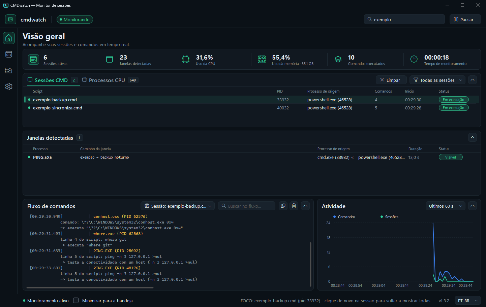
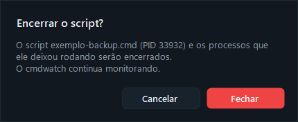
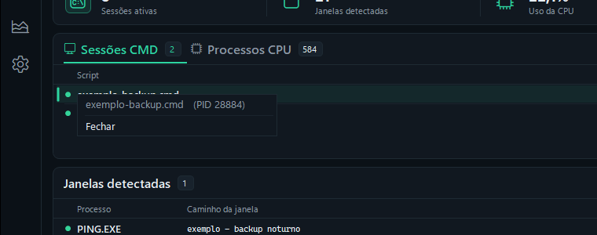
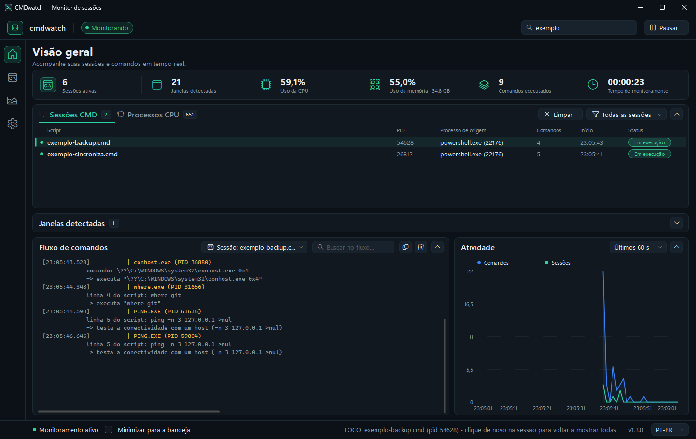
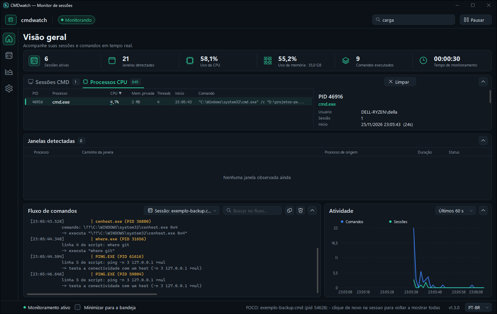
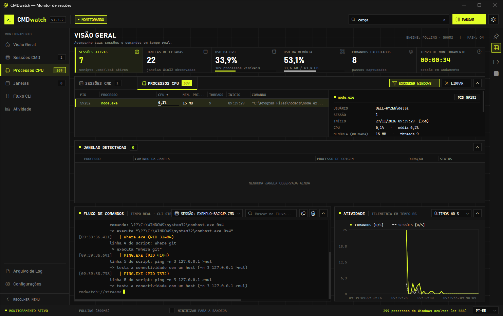
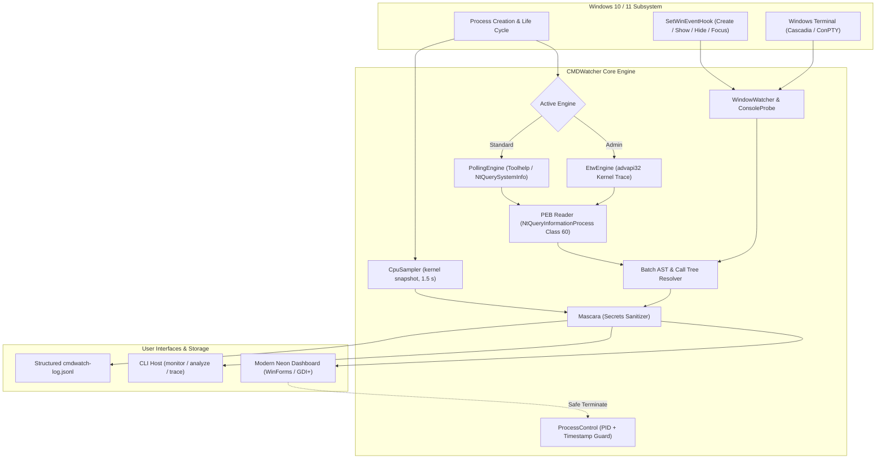

<div align="center">

# ⚡ CMDWatcher (cmdwatch)

**Real-time execution monitor & window author tracer for `.cmd`/`.bat` scripts and background processes on Windows 10/11**

[](https://microsoft.com/windows)
[-512BD4.svg?style=flat&logo=dotnet)](https://dotnet.microsoft.com)
[](https://docs.microsoft.com/dotnet/csharp/)
[%20%7C%20Portable-success.svg?style=flat)](https://github.com/dellanio/cmdwatch/releases)
[](https://github.com/dellanio/cmdwatch)
[](LICENSE)

*Track popping console windows, identify the exact root-cause process behind every terminal, and monitor AI agent automation scripts in real time.*

[Português (README.pt-BR.md)](README.pt-BR.md)

</div>

---

## 📸 Screenshots & UI

<div align="center">
  <table>
    <tr>
      <td align="center"><b>Modern Real-Time Neon Dashboard (Dark Theme)</b></td>
      <td align="center"><b>Safe Process Termination with PID Guard</b></td>
    </tr>
    <tr>
      <td align="center">
        
      </td>
      <td align="center">
        
      </td>
    </tr>
    <tr>
      <td align="center"><b>Right-Click Context Actions on Windows & Sessions</b></td>
      <td align="center"><b>Collapsible Panels & Adaptive Layout</b></td>
    </tr>
    <tr>
      <td align="center">
        
      </td>
      <td align="center">
        
      </td>
    </tr>
    <tr>
      <td align="center" colspan="2"><b>"CPU Processes" tab: a live picture of the machine, list + detail</b></td>
    </tr>
    <tr>
      <td align="center" colspan="2">
        
      </td>
    </tr>
    <tr>
      <td align="center" colspan="2"><b>"Hide Windows": only what you installed stays in the list</b></td>
    </tr>
    <tr>
      <td align="center" colspan="2">
        
      </td>
    </tr>
  </table>
</div>

---

## ⚡ The Problem

With the widespread adoption of **autonomous AI agents, background automation scripts, and build tools**, developers' workstations run dozens of unmonitored scripts. Over time:
- Random CMD windows flash on screen, stealing focus in the middle of typing;
- Hidden background batch files consume CPU and memory undetected;
- Standard Task Manager only lists generic `cmd.exe` processes without showing **who called them** (was it an AI agent, an IDE extension, a Windows scheduled task, or malware?).

---

## 💡 The Solution: CMDWatcher

**CMDWatcher** (`cmdwatch`) is a lightweight, zero-dependency utility for Windows 10/11 designed to answer four critical questions in real time:

1. **Which `.cmd`/`.bat` script was executed?** Exact script path and full command-line arguments.
2. **Who started it?** Complete ancestor chain (parent, grandparent... all the way to root).
3. **What is it doing right now?** The exact command executing at this moment (even across nested `call` chains), translated into human-readable explanation.
4. **Which window appeared on screen, and who is behind it?** The true author process, duration on screen, focus count, and visibility state.

> **Neutral Evidence:** cmdwatch does not make arbitrary guesses or label processes as "AI" or "system". It delivers **concrete, timestamped forensic proof** so you can make informed decisions.

| Ancestor Chain Shown by cmdwatch | Real-World Context |
|---|---|
| `node.exe` → `python.exe script_pai.py` → `git.exe` | Launched by your AI agent / Node.js development tool |
| `svchost.exe` → `cmd.exe /c cleanup.cmd` | Triggered by a Windows **Scheduled Task** |

---

## 🚀 Key Features

- 📦 **Single Portable Executable:** ~612 KB compiled with C# (.NET Framework 4.8, already pre-installed on Windows). Zero installer, zero external DLLs.
- 🛡️ **No Administrator Rights Required:** Inspects processes, parameters, and PEB memory (`NtQueryInformationProcess`) without requiring elevation.
- 🔍 **Accurate Console Author Resolution (ConPTY / Cascadia):** In Windows Terminal, seamlessly correlates `CASCADIA_HOSTING_WINDOW_CLASS` host windows with their underlying `PseudoConsoleWindow`, identifying the real author rather than `WindowsTerminal.exe`.
- ⚡ **Dual Capture Engines (Polling & Kernel ETW):**
  - *Standard Mode:* High-speed adaptive polling using Toolhelp32 snapshots and `SystemProcessInformation`.
  - *ETW Kernel Mode (with Admin):* Intercepts kernel trace events in real time without missing short-lived scripts (< 25 ms).
- 🔒 **Active Secret Masking:** Automatically redacts tokens, passwords, API keys, `Authorization: Bearer` headers, and AWS credentials before saving to logs or rendering on screen.
- 🛑 **Safe Process Tree Termination (PID Reuse Guard):** Safely terminates runaway scripts and child process trees directly from the UI, with strict creation timestamp verification (`GetProcessTimes`) preventing accidental termination of recycled PIDs.
- 🖥️ **Live CPU & Process Inspector:** a second tab inside the sessions card lists every process on the machine with its CPU share, private memory, thread count and start time, next to a detail pane with the owner, session, command line and ancestry chain. The numbers come from the kernel snapshot, at no extra read cost.
- 🙈 **Hide the Windows processes:** the "Hide Windows" button takes everything from the system out of the list (`C:\Windows` and the protected services) and leaves only what you installed yourself — 635 processes become 356 on a normal machine, in ~15 ms the first time and nothing after that.
- 📐 **Adjustable panel:** the table columns (in both tabs) and the divider between the list and the detail can be resized by dragging with the mouse.
- 📦 **Installs through Scoop and winget:** both package managers deliver the executable **without** the SmartScreen warning and without an installer — `cmdwatch` ends up on the `PATH`.
- 🎨 **Custom Neon UI:** Lightweight GDI+ rendering with Dark and Light themes, real-time search, sortable columns, and background minimization to the Windows System Tray.

---

## 🏗️ Architecture & Data Flow



- **Language:** C# (.NET Framework 4.8)
- **UI Toolkit:** Pure Windows Forms with custom GDI+ drawing (Dark / Light)
- **Native APIs:** `kernel32.dll`, `user32.dll`, `ntdll.dll` (`NtQueryInformationProcess`), `advapi32.dll` (ETW)
- **Build System:** Self-bootstrapping PowerShell script (`build.ps1`) using Roslyn compiler

---

## 📦 Download & Getting Started

Download the pre-compiled binary:

**[⬇ Download cmdwatch v1.3.2 — cmdwatch.exe](https://github.com/dellanio/cmdwatch/releases/latest/download/cmdwatch.exe)**

### Install with Scoop (recommended on Windows)

Scoop installs the file **without** the Mark-of-the-Web flag: Windows shows
**no SmartScreen warning** ("Windows protected your PC") and `cmdwatch` ends up
on the `PATH`, ready to call from any terminal.

```powershell
scoop bucket add dellanio https://github.com/dellanio/scoop-bucket
scoop install cmdwatch
cmdwatch
```

### Install with winget (Windows Package Manager)

```powershell
winget install dellanio.cmdwatch
```

> The submission to the official winget repository is **under review** by the
> Microsoft maintainers ([PR #489709](https://github.com/microsoft/winget-pkgs/pull/489709)).
> Once it is approved, the command above works out of the box.

winget also installs **without** the SmartScreen warning. The manifest is
generated and validated on every release by `tools/gerar-winget.ps1`.

### Why the SmartScreen warning shows up on a direct download

Downloading the `.exe` with a browser marks the file with the *Mark-of-the-Web*,
and Windows shows the blue "Windows protected your PC" warning until the file
gains reputation. **Installing through Scoop or winget has no such problem**:
the file reaches the program folder without the mark and Windows runs it
directly.

The other way to remove the warning is to **sign the executable** (Authenticode
with a certificate from a trusted CA). cmdwatch is applying to the
[SignPath Foundation](https://signpath.org/) program, which issues free
Authenticode certificates to qualifying open-source projects — see the
[Code signing policy](#code-signing-policy) below. Until the certificate
arrives, the published binaries are **not signed yet**, but they do not need to
be to install without a warning through the two package managers above.

### Code signing policy

cmdwatch takes part in the [SignPath Foundation](https://signpath.org/) program:
the Windows executable of each release is signed with an Authenticode
certificate issued to **SignPath Foundation**, and every signing request is
approved by an approver of this project before the release is published.

> Free code signing provided by [SignPath.io](https://about.signpath.io/),
> certificate by [SignPath Foundation](https://signpath.org/)

| Role | Member |
|---|---|
| **Authors** — trusted to commit without further review | [dellanio](https://github.com/dellanio) (sole maintainer and repository owner) |
| **Reviewers** — review every change proposed by a non-committer | [dellanio](https://github.com/dellanio) |
| **Approvers** — approve each signing request | [dellanio](https://github.com/dellanio) |

**Privacy:** This program will not transfer any information to other networked
systems unless specifically requested by the user or the person installing or
operating it. There is no telemetry, no update check and no network code in
cmdwatch — the only files it writes are the local log (`cmdwatch-log.jsonl`)
and the local preferences (`%APPDATA%\cmdwatch\ui.cfg`). See also the
[Security & Privacy Model](#-security--privacy-model) section.

**Uninstall:** cmdwatch is a portable single-file program. It installs nothing
and changes no system setting — deleting `cmdwatch.exe` (and, optionally, the
`%APPDATA%\cmdwatch` folder) removes it completely.

**Status:** the application to the SignPath Foundation was submitted on
2026-11-26 and is under review. Until the certificate is issued, the released
binaries are unsigned — install through Scoop or winget to avoid the
SmartScreen prompt.

### Launching the Graphical Dashboard
Simply **double-click** `cmdwatch.exe` or execute from any terminal:

```powershell
cmdwatch.exe
```

### Command-Line Modes (CLI)

```powershell
# Continuous monitoring output to the console
cmdwatch.exe monitor

# Stream real-time events as newline-delimited JSON (JSONL)
cmdwatch.exe monitor --json

# Static code analysis (explains what a script does without running it)
cmdwatch.exe analyze script.cmd

# Execute a script step-by-step and trace exact runtime command progression
cmdwatch.exe trace script.cmd
```

#### Monitor Options:
| Flag | Description |
|---|---|
| `--log <file>` | Path to the structured JSONL output log (default: `cmdwatch-log.jsonl`) |
| `--engine <auto\|polling\|wmi\|etw>` | Selects process capture engine (default: `auto`) |
| `--interval <ms>` | Idle polling interval (default: 500 ms) |
| `--fast-interval <ms>` | Polling interval during active script execution (default: 50 ms) |
| `--filter <text>` | Only reports `.cmd` scripts matching substring |
| `--no-windows` | Disables window tracking on screen |
| `--no-mask` | Disables sensitive data redaction |

---

## ⚙️ Capture Engines Comparison

| Engine | Privileges | Best For | Technical Details |
|---|:---:|---|---|
| **polling** *(default)* | Standard User | Everyday development | Uses `CreateToolhelp32Snapshot` and `SystemProcessInformation`. Adaptive intervals: 500 ms (idle), 50 ms (active). |
| **etw** | Administrator | Ultra-short scripts (< 50 ms) | Creates a dedicated Event Tracing for Windows session (`CMDWatcher-Processos`). Kernel passes process command-lines directly in the event payload. |
| **wmi** | Administrator | Alternate diagnostics | Listens to `Win32_ProcessStartTrace` events. |

---

## 🖥️ The "CPU Processes" Tab

The **CMD Sessions** card became a two-tab card: **CMD Sessions** (unchanged behavior) and
**CPU Processes**, which shows a live picture of the machine. The KPI strip gains a fifth card,
**CPU usage**, with the machine-wide total in real time, and a sixth one, **Memory usage**, with
the physical memory in use in real time.


**The list (62% of the card)** has one row per process:

| Column | Source |
|---|---|
| **PID** | from the kernel snapshot |
| **Process** | executable name |
| **CPU** | share of the whole machine right now, with a bar |
| **Private mem** | private working set (see the caveat below) |
| **Threads** | thread count |
| **Started** | process creation time |
| **Command** | command line (with the secret masker applied) |

Clicking a header sorts by that column; the top search box filters the list.

**The detail pane (38% of the card)** shows, for the selected process: PID and name, an **elevated**
pill when the process runs with high integrity, the **user** who owns it, the **session**, the
**start time** and how long it has been alive, **instant and average CPU**, **memory** and
**threads**, the **executable**, the **command line** wrapped over several lines, and the
**ancestry chain** (who called whom).

### Resizable: drag to adjust

- **In both tabs**, the border between the header columns can be dragged: the cursor turns into
  a double arrow, the column gains or gives up space and the flexible column absorbs the difference.
- **In the "CPU Processes" tab**, the divider between the list (left) and the detail (right) is
  draggable too: the detail gains or loses width as you pull.

### 🔍 Hiding the Windows processes

The **Hide Windows** button, in the card header (it only shows up in the "CPU Processes" tab),
takes the system processes out of the list and leaves only what you installed yourself. Measured
on this machine: the list drops from **635 to 356 processes** — the `svchost.exe` (95 copies),
`explorer.exe`, `lsass.exe` and `cmd.exe` go away, and what is left is what you installed.


*The capture: with the button on, the `cmd.exe` (which is Windows) leaves the list and the
`node.exe` — running outside `C:\Windows` — stays.*

The rule is the executable path:

- **inside `C:\Windows`** → it is Windows (`svchost.exe`, `explorer.exe`, `cmd.exe`,
  `powershell.exe`…);
- **protected system service** (the ones that refuse to give up their path: `svchost`, `lsass`,
  `csrss`, `Registry`, `Secure System`…) → also Windows;
- **everything else stays visible**: programs in `C:\Program Files`, in your user folder, in Scoop,
  in `D:\ferramentas`, the Microsoft Store apps (`WindowsApps` folder) and the vendor services
  (NVIDIA, Dell, HP, NordVPN, Tailscale…) — you installed those, so they stay.

A process path does not change while it lives, so the query is done once per (pid, start time)
and cached: opening ~600 processes costs **~15 ms**, only the first time (measured: 19 ms on the
first pass, 0 ms on the next ones).

Nothing is terminated — the button only changes what the list shows. The tab counter tells how
many processes are visible, and the choice is saved in `ui.cfg`: next time you open the panel,
Windows stays hidden (or the way you left it).

### How the numbers are computed

The kernel snapshot (`NtQuerySystemInformation`) already returns, in the same buffer and at **no
extra read cost**, the accumulated CPU time, the memory, the thread count and the creation time of
every process. The panel compares two snapshots (one every 1.5 s, on its own thread, which does not
disturb the event engine) and turns the difference in CPU time into a percentage:

- the percentage is **normalized by the number of cores** (0–100%): the sum of all processes equals the machine total (measured: 21.6% of the processes = 21.6% of the machine);
- the **machine total** leaves out the idle process (PID 0);
- the **average** is computed separately, over the whole life of the process;
- the **command line** is only read for the top 40 processes (each read is a PEB call).

### Honest limitations

- **Memory is the *private working set***, not total RSS — the kernel snapshot does not carry the raw working set. That is why the column reads "Private mem" (a shared `svchost.exe` shows only a few KB).
- The percentage is **of the whole machine**, not of a single core: 6% means 6% of all 16 cores together.
- **Working directory and environment variables are not read**: they require `PROCESS_VM_READ` and fail on elevated processes.
- **User and integrity level** come from the process token, read once per process (the token does not change while it lives); protected processes may not answer.
- The list shows **every** process on the machine (500+ in normal use) — or only the ones you installed, with the **Hide Windows** button; the snapshot costs a few milliseconds.

---

## ⚡ Performance and footprint (v1.3.0)

The cmdwatch is measured, not optimized in the dark. The full evaluation — with the before, the
after and the reason behind each change — lives in
[`docs/otimizacao-1.3.0.md`](docs/otimizacao-1.3.0.md).

| Measurement | Before (v1.2.0) | After (v1.3.0) |
|---|---|---|
| Full panel tick (CPU tab closed) | ~0,20 ms | **0,023 ms** (−84%) |
| Command-line read of the top 40 processes | 2 reads per sample | 1 read per process, cached by PID + start time |
| CPU list rebuild | every tick | only when the snapshot or the filter changes, and only while the tab is open |
| Secret masking | on every table repaint | once per sample |
| Panel in the tray | timers and sampler running | timers and sampler **stopped** (the engine and the log keep running) |
| App footprint with the GUI visible | 0.60% of the machine | within the ±0.2% noise — the real gain is in the per-tick work |
| Working set | ~59–64 MB | ~60 MB |

The biggest cost is still the **kernel snapshot** (10.5–13.4 ms per call): that is the price of
detecting when processes start and end. What v1.3.0 reduced was how many times it gets paid in
parallel.

To measure it again:

```powershell
powershell -File .\tools\medir-consumo.ps1 -Exe .\out\cmdwatch.exe -Segundos 60
```

---

## 🐛 v1.3.1 fix (the log that vanished silently)

The default log path (`cmdwatch-log.jsonl`) is **relative**: it lands next to
the script the user runs. That works while the current directory is writable —
but not when it is not:

| Situation | Before | Now |
|---|---|---|
| Current directory writable | log next to the script | **same** |
| Current directory not writable (installer, MSIX package, network share) | the log **did not exist**, with no warning at all | log goes to `%LOCALAPPDATA%\cmdwatch` and the header **says** where it ended up |
| Absolute path not allowed (`--log C:\...`) | nothing, no warning | the log stays off, but the **reason shows up** |
| Path shown in the header | the *requested* path | the **real** path (the "open log" button and the settings screen follow the same one) |

An absolute path is the user's explicit intent, so it is respected: cmdwatch
does not redirect a `--log C:\...` somewhere else — it opens it, or explains why
it could not.

The warning shows up in the header (the same block in the terminal and in the
panel):

```
    log        : C:\Users\you\AppData\Local\cmdwatch\cmdwatch-log.jsonl
    filtro     : (todos)
capturando ... (Ctrl+C to exit)
    aviso      : log movido para C:\Users\you\AppData\Local\cmdwatch\cmdwatch-log.jsonl: o diretório atual não permite escrita
```

Smaller detail that also changed: the log written by the panel is now stored
**without a BOM** (the terminal one already was) — JSONL with a BOM breaks
strict readers such as `jq`.

---

## 🐛 v1.1.1 fixes (field test of v1.1.0)

Four defects found during the field test, all measured before being fixed:

| Defect | Measured cause | Fix |
|---|---|---|
| **Elevated processes went missing from the log** | the limited query called a function name that does not exist in `ntdll.dll`; the error was swallowed by a `catch` and the read fell back to the PEB — which an elevated process blocks | correct `EntryPoint`: the query now reads the command line of elevated processes (measured: **6 of 6** high-integrity processes; the `Higiene-Remocao` scheduled task, which runs as administrator, was captured live with the elevated command line) |
| **The window showed the program, not who called it** | the author was picked as the **most recent** console client (the transient `git.exe`) | the author is now the **nearest ancestor inside the console, excluding the root**: in a `cmd.exe → python.exe → git.exe` chain the author is the `python.exe` (the caller), and the `git.exe` is recorded as the *program* in execution (the `program` field) |
| **A hidden window turned into "closed"** | for some windows of another process the cross-process query **does not answer** (empty class, handle outside the enumeration) — **while the window owner sees it normally**; cmdwatch concluded it "died" | the destroy event no longer closes anything (it only flags); the sweep closes only after **two consecutive sweeps** of absence and, while the **owning process** is alive, waits 30 s. Measured: hiding → `window_hide` with `closed=false`, and the window **does not** come back as a new window |
| **`sessionId` coming out as 59133952** | the field was read at the wrong offset (`0x68` = `UniqueProcessKey`) | corrected to `0x64`, measured across 859 records on this machine |

**Honest limitation:** when a window does not answer the cross-process query, cmdwatch **cannot see it
again** — it stays registered as *hidden* instead of returning to "visible". And a `.cmd` with **no
window at all** (`CreateNoWindow`) that lives for ~90 ms still depends on the engine interval (in the
slow 500 ms regime: 0/6 to 2/8; with `--interval 50`: 4/6 to 8/8).

---

## 🔒 Security & Privacy Model

- **Non-Invasive Observation:** cmdwatch does not inject DLLs into foreign processes, does not install kernel filter drivers, and never alters or blocks OS scheduling.
- **Automatic Secret Sanitization:** Command-lines pass through regex rules in `Mascara.cs` before persistence or display. Flags like `--password`, `--token`, `Authorization: Bearer`, credentialed URLs, and AWS access keys have values replaced with `***`.
- **PID Recycling Protection:** When requesting process termination, cmdwatch queries the process creation time (`GetProcessTimes`). If the process has already exited and Windows reassigned the PID to an unrelated program, the operation safely aborts.
- **100% Local & Zero Telemetry:** Everything runs strictly offline. No telemetry, no background network connections, and no cloud dependencies.

---

## 🛠️ Building & Automated Testing

### Building from Source:
Use the included `build.ps1` script, which automatically acquires the Roslyn compiler toolset:

```powershell
git clone https://github.com/dellanio/cmdwatch.git
cd cmdwatch

# Compile cmdwatch.exe into out/
.\build.ps1
```

### Running the Test Suite:
Scripts in `tools/` execute end-to-end regression verifications:

```powershell
# Run functional test battery for resolved defects (D1 to D5)
powershell -ExecutionPolicy Bypass -File .\tools\test-defeitos.ps1

# Verify window ancestor chain and hover tooltips
powershell -ExecutionPolicy Bypass -File .\tools\test-cadeia-janelas.ps1

# Test safe window process termination
powershell -ExecutionPolicy Bypass -File .\tools\test-encerrar-janela.ps1
```

---

## 📄 License

This project is licensed under the **MIT License**. See the [LICENSE](LICENSE) file for details.
