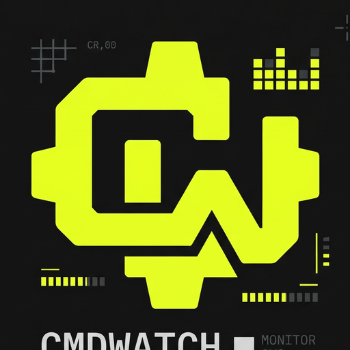
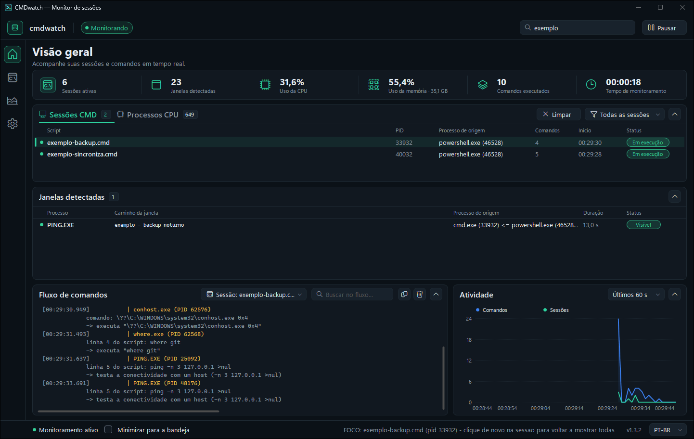
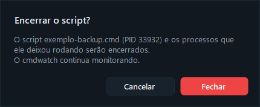
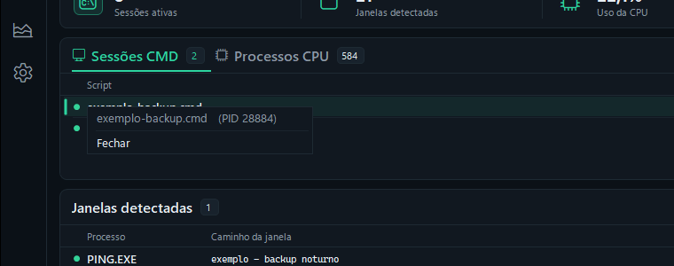
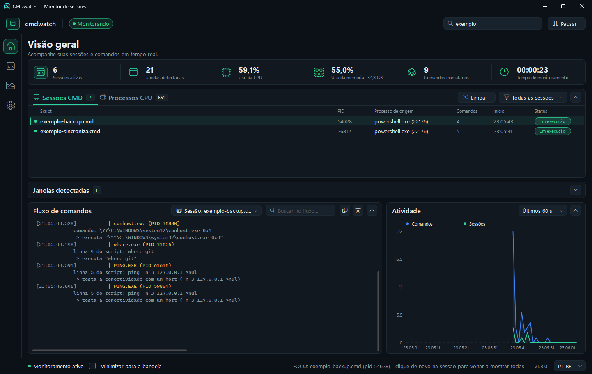
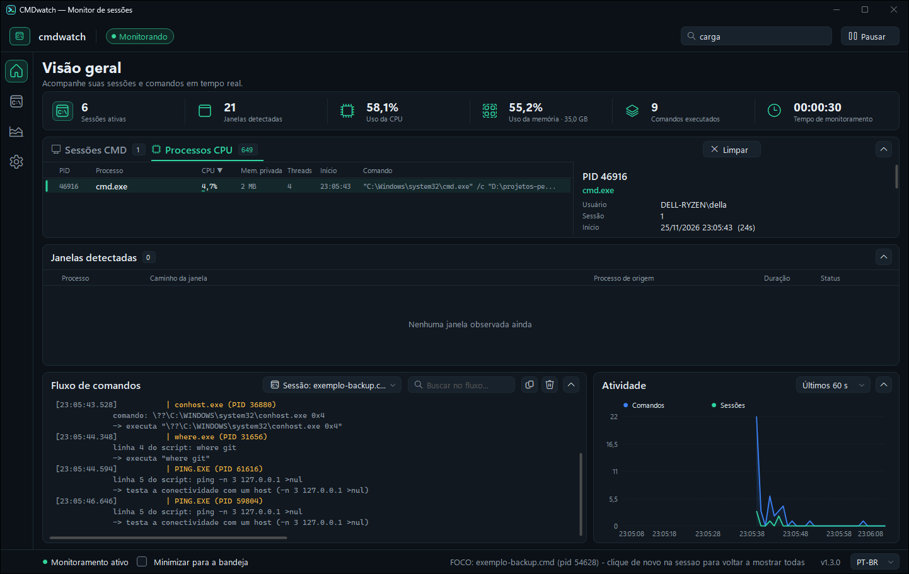
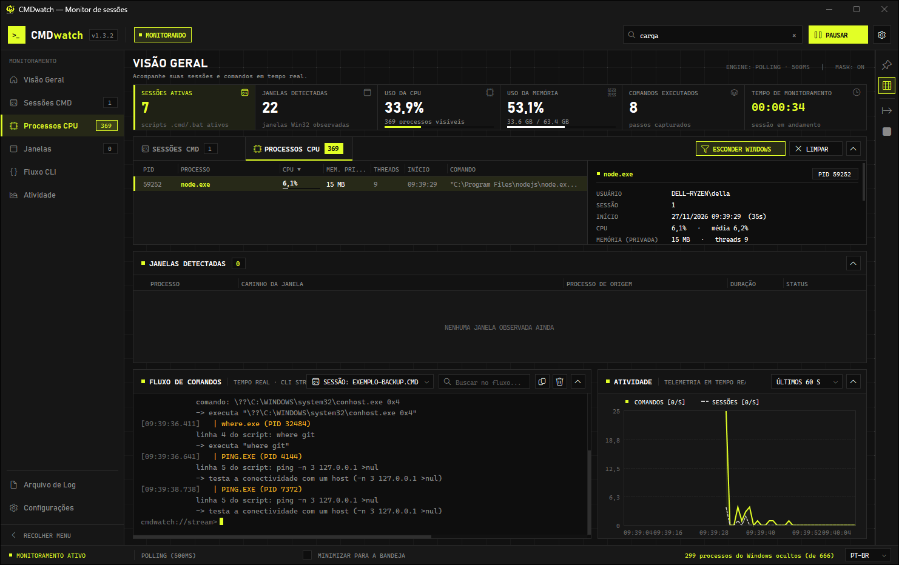
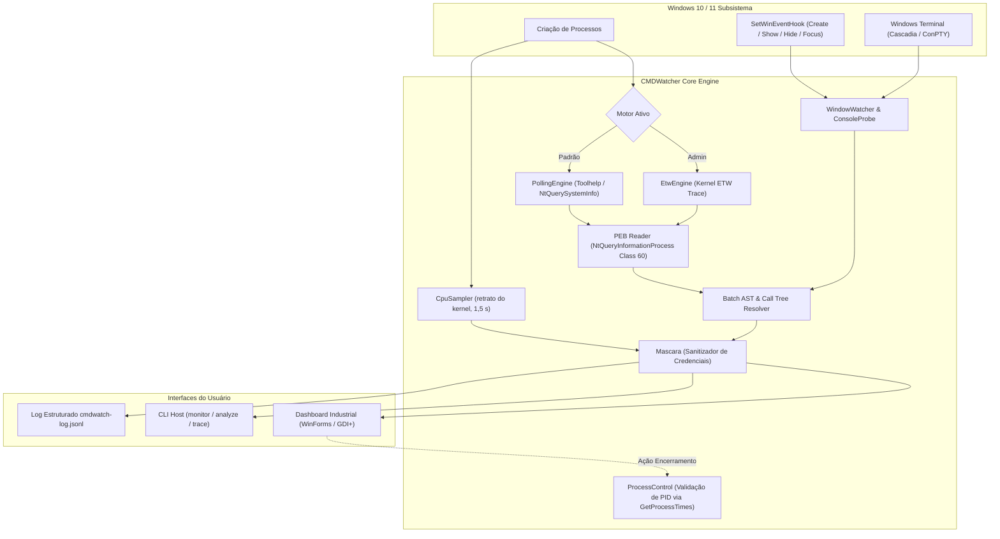

<div align="center">



# CMDWatcher (cmdwatch)

**Monitor de execução em tempo real e rastreador de janelas e scripts `.cmd`/`.bat` para Windows 10/11**

[](https://microsoft.com/windows)
[-512BD4.svg?style=flat&logo=dotnet)](https://dotnet.microsoft.com)
[](https://docs.microsoft.com/dotnet/csharp/)
[%20%7C%20Portátil-success.svg?style=flat)](https://github.com/dellanio/cmdwatch/releases)
[](https://github.com/dellanio/cmdwatch)
[](LICENSE)

*Identifique janelas que piscam na tela, descubra o processo autor exato por trás de cada console e monitore execuções de agentes de IA em segundo plano.*

[English (README.md)](README.md)

</div>

---

## 📸 Capturas de Tela & Interface

<div align="center">
  <table>
    <tr>
      <td align="center"><b>Painel Industrial em Tempo Real (Tema Escuro, estilo Hoody)</b></td>
      <td align="center"><b>Encerramento Seguro de Processos com Confirmação</b></td>
    </tr>
    <tr>
      <td align="center">
        
      </td>
      <td align="center">
        
      </td>
    </tr>
    <tr>
      <td align="center"><b>Menu de Contexto em Sessões e Janelas</b></td>
      <td align="center"><b>Cartões Recolhíveis e Layout Adaptativo</b></td>
    </tr>
    <tr>
      <td align="center">
        
      </td>
      <td align="center">
        
      </td>
    </tr>
    <tr>
      <td align="center" colspan="2"><b>Aba "Processos CPU": retrato ao vivo da máquina, com lista e detalhe</b></td>
    </tr>
    <tr>
      <td align="center" colspan="2">
        
      </td>
    </tr>
    <tr>
      <td align="center" colspan="2"><b>"Esconder Windows": na lista fica só o que você instalou por fora</b></td>
    </tr>
    <tr>
      <td align="center" colspan="2">
        
      </td>
    </tr>
  </table>
</div>

---

## ⚡ O Problema

Com o uso intensivo de **agentes autônomos de IA, ferramentas de automação e tarefas em segundo plano**, dezenas de scripts são disparados na máquina do desenvolvedor. Com o tempo:
- Terminais e janelas de CMD surgem do nada e roubam o foco durante a digitação;
- Scripts ocultos executam em background consumindo CPU e memória;
- O Gerenciador de Tarefas do Windows mostra apenas `cmd.exe` genéricos, tornando impossível saber **quem chamou** o script (se foi a IA, o VS Code, uma tarefa agendada ou o próprio Windows).

---

## 💡 A Solução: CMDWatcher

O **CMDWatcher** (`cmdwatch`) é um monitor leve e sem dependências para Windows 10/11 que responde em tempo real a quatro perguntas fundamentais:

1. **Qual `.cmd`/`.bat` foi executado?** O caminho exato do script e seus argumentos.
2. **Quem chamou?** A cadeia completa de ancestrais (pai, avô... até a raiz).
3. **O que ele está fazendo agora?** Qual comando interno roda na linha exata do script (inclusive dentro de rotinas `call` encadeadas), com explicação em linguagem humana.
4. **Que janela abriu e quem está por trás dela?** O processo autor real, duração em tela, histórico de foco e estado de visibilidade.

> **Auditoria Neutra:** O cmdwatch não rotula arbitrariamente o que é "bom" ou "ruim", nem se o processo é "IA". Ele entrega as **evidências técnicas irrefutáveis** para você tomar o controle.

| Cadeia Apresentada pelo cmdwatch | Interpretação Real |
|---|---|
| `node.exe` → `python.exe script_pai.py` → `git.exe` | Criado pelo seu agente de IA / extensão Node.js |
| `svchost.exe` → `cmd.exe /c higiene.cmd` | Disparado pelo **Agendador de Tarefas** do Windows |

---

## 🚀 Recursos Principais

- 📦 **Executável Único & Portátil:** ~612 KB compilado em C# (.NET Framework 4.8 já embutido no Windows). Sem instalador, sem DLLs e sem runtime extra.
- 🛡️ **Zero Elevação Obrigatória:** Lê processos e linhas de comando diretamente do PEB (`NtQueryInformationProcess`) sem requerer privilégios de Administrador.
- 🔍 **Descoberta do Autor do Console (ConPTY / Cascadia):** No Windows Terminal, associa automaticamente as janelas `CASCADIA_HOSTING_WINDOW_CLASS` à sua respectiva `PseudoConsoleWindow`, identificando o processo autor de verdade em vez do hospedeiro da UI.
- ⚡ **Motor Duplo (Polling & ETW Kernel):**
  - *Modo Padrão:* Polling adaptativo rápido (Toolhelp32 / `SystemProcessInformation`).
  - *Modo ETW (Kernel Trace):* Com privilégio de Administrador, escuta eventos em tempo real do kernel do Windows sem perder scripts ultracurtos (~25 ms).
- 🔒 **Máscara Automática de Segredos:** Sanitiza tokens, senhas, chaves de API, cabeçalhos `Bearer` e credenciais AWS antes de gravar em disco ou renderizar na tela.
- 🛑 **Encerramento Seguro contra Colisão de PID:** Permite encerrar scripts e árvores de processos pela UI com verificação rigorosa de data/hora de criação do PID (`GetProcessTimes`), impedindo matar processos reciclados.
- 🖥️ **Inspetor de CPU e Processos ao Vivo:** uma segunda aba dentro do cartão de sessões lista todos os processos da máquina com consumo de CPU, memória privada, threads e hora de início, ao lado de um painel de detalhe com dono, sessão, linha de comando e cadeia de ancestrais. Os números saem do retrato do kernel, sem custo extra de leitura.
- 🙈 **Esconder os processos do Windows:** o botão "Esconder Windows" tira da lista tudo que é do sistema (`C:\Windows` e os serviços protegidos) e deixa só o que você instalou por fora — 635 processos viram 356 numa máquina comum, em ~15 ms na primeira vez e nada depois.
- 📐 **Painel ajustável:** as colunas das tabelas (nas duas abas) e a divisória entre a lista e o detalhe podem ser redimensionadas arrastando com o mouse.
- 📦 **Instala pelo Scoop e pelo winget:** os dois gerenciadores entregam o executável **sem** o aviso do SmartScreen e sem pedir instalação — o `cmdwatch` fica no `PATH`.
- 🎨 **Interface Industrial (estilo Hoody):** GDI+ puro, plana e de cantos retos — destaque amarelo ácido `#E2FF26` sobre fundo grafite, bordas estruturais de 1 px, barra lateral retrátil com contadores ao vivo, barra superior com busca global e Pausar/Retomar, e faixa de indicadores (sessões, janelas, CPU, memória, comandos, tempo ativo). Escuro por padrão; há uma variante clara de alto contraste com `CMDWATCH_TEMA=claro`.
- 🧰 **Utilitários reais, nada simulado:** um trilho à direita e uma gaveta de configurações com **Fixar no topo** (pin), **grade arquitetônica 40×40 px**, **Exportar log** (salva o fluxo atual) / **Abrir log** e **Minimizar para a bandeja**. Cada escolha é lembrada entre execuções.

---

## 🏗️ Arquitetura & Fluxo de Dados



- **Linguagem:** C# (.NET Framework 4.8)
- **UI Toolkit:** Windows Forms com renderização GDI+ sob demanda (tema escuro estilo Hoody, variante clara sob pedido) — sem DLLs extras
- **APIs Nativas:** `kernel32.dll`, `user32.dll`, `ntdll.dll` (`NtQueryInformationProcess`), `advapi32.dll` (ETW)
- **Build System:** Script autônomo PowerShell (`build.ps1`) com compilador Roslyn embutido

---

## 📦 Download & Uso Rápido

Baixe o executável pronto para uso:

**[⬇ Baixar cmdwatch v1.3.2 — cmdwatch.exe](https://github.com/dellanio/cmdwatch/releases/latest/download/cmdwatch.exe)**

### Instalar pelo Scoop (recomendado no Windows)

O Scoop instala o arquivo **sem** a marca "Mark-of-the-Web": o Windows **não
mostra o aviso do SmartScreen** ("O Windows protegeu o seu PC") e o `cmdwatch`
fica no `PATH`, pronto para chamar de qualquer terminal.

```powershell
scoop bucket add dellanio https://github.com/dellanio/scoop-bucket
scoop install cmdwatch
cmdwatch
```

### Instalar pelo winget (Windows Package Manager)

```powershell
winget install dellanio.cmdwatch
```

> A submissão ao repositório oficial do winget está **em análise** pelos
> mantenedores da Microsoft ([PR #489709](https://github.com/microsoft/winget-pkgs/pull/489709)).
> Depois que for aprovada, o comando acima passa a funcionar direto.

O winget também instala **sem** o aviso do SmartScreen. O manifesto é gerado e
validado a cada release por `tools/gerar-winget.ps1`.

### Por que o aviso do SmartScreen aparece no download direto

Baixando o `.exe` pelo navegador, o Windows marca o arquivo com
*Mark-of-the-Web* e mostra o aviso azul "O Windows protegeu o seu PC" até o
arquivo ganhar reputação. **Instalar pelo Scoop ou pelo winget não tem esse
problema**: o arquivo chega à pasta do programa sem a marca, e o Windows o
executa direto.

A outra forma de tirar o aviso é **assinar o executável** (Authenticode com um
certificado de uma AC confiável). O cmdwatch está se candidatando ao programa da
[SignPath Foundation](https://signpath.org/), que emite certificados Authenticode
gratuitos a projetos open source qualify — veja a
[Política de assinatura](#política-de-assinatura-code-signing-policy) abaixo.
Enquanto o certificado não chega, os binários publicados **ainda não são
assinados**, mas também não precisam ser para ser instalado sem aviso pelos dois
gerenciadores acima.

### Política de assinatura (Code signing policy)

O cmdwatch participa do programa da [SignPath Foundation](https://signpath.org/):
o executável de cada release é assinado com um certificado Authenticode emitido
em nome da **SignPath Foundation**, e cada pedido de assinatura é aprovado por um
aprovador do projeto antes de a release ser publicada.

> Free code signing provided by [SignPath.io](https://about.signpath.io/),
> certificate by [SignPath Foundation](https://signpath.org/)

| Papel | Membro |
|---|---|
| **Authors** — podem commitar sem revisão adicional | [dellanio](https://github.com/dellanio) (único mantenedor e dono do repositório) |
| **Reviewers** — revisam toda mudança proposta por quem não é committer | [dellanio](https://github.com/dellanio) |
| **Approvers** — aprovam cada pedido de assinatura | [dellanio](https://github.com/dellanio) |

**Privacidade:** This program will not transfer any information to other networked
systems unless specifically requested by the user or the person installing or
operating it. — Ou seja: o cmdwatch não transfere nenhuma informação para outros
sistemas em rede sem solicitação explícita de quem o instala ou o opera. Não há
telemetria, verificação de atualização nem código de rede: os únicos arquivos
gravados são o log local (`cmdwatch-log.jsonl`) e as preferências locais
(`%APPDATA%\cmdwatch\ui.cfg`). Veja também o
[Modelo de Segurança & Privacidade](#-modelo-de-segurança--privacidade).

**Desinstalação:** o cmdwatch é um programa portátil de arquivo único. Não
instala nada e não altera configuração do sistema — apagar o `cmdwatch.exe` (e,
se quiser, a pasta `%APPDATA%\cmdwatch`) remove o programa por completo.

**Situação:** o pedido de assinatura à SignPath Foundation foi preparado em
2026-11-26 e aguarda submissão pelo dono do repositório. O certificado ainda
não foi emitido, então os binários publicados seguem sem assinatura — instale
pelo Scoop ou pelo winget para evitar o aviso do SmartScreen.

### Abrir o Painel Gráfico
Dê **duplo clique** no `cmdwatch.exe` ou execute via terminal:

```powershell
cmdwatch.exe
```

### Modos de Linha de Comando (CLI)

```powershell
# Monitora o sistema continuamente e exibe no terminal
cmdwatch.exe monitor

# Saída direta em JSONL para integração com outras ferramentas
cmdwatch.exe monitor --json

# Análise estática de um script (explica comandos sem executá-lo)
cmdwatch.exe analyze script.cmd

# Executa o script passo a passo e captura a sequência exata de comandos
cmdwatch.exe trace script.cmd
```

#### Opções do Monitor:
| Parâmetro | Descrição |
|---|---|
| `--log <arquivo>` | Caminho do arquivo JSONL de saída (padrão: `cmdwatch-log.jsonl`) |
| `--engine <auto\|polling\|wmi\|etw>` | Seleciona o motor de captura (padrão: `auto`) |
| `--interval <ms>` | Intervalo de amostragem parado (padrão: 500 ms) |
| `--fast-interval <ms>` | Intervalo acelerado durante execução de scripts (padrão: 50 ms) |
| `--filter <texto>` | Filtra apenas `.cmd` cujo caminho contenha o termo |
| `--no-windows` | Desativa a observação de janelas da tela |
| `--no-mask` | Desativa a máscara de dados confidenciais |

---

## ⚙️ Motores de Captura

| Motor | Permissão | Cenário Ideal | Detalhes Técnicos |
|---|:---:|---|---|
| **polling** *(padrão)* | Usuário Comum | Uso diário geral | Consulta snapshots de processos pelo `CreateToolhelp32Snapshot` e `SystemProcessInformation`. Intervalo dinâmico de 500 ms (repouso) e 50 ms (atividade). |
| **etw** | Administrador | Scripts ultracurtos (< 50 ms) | Cria uma sessão dedicada no Event Tracing for Windows (`CMDWatcher-Processos`). O kernel entrega a linha de comando direto no payload do evento, sem perdas. |
| **wmi** | Administrador | Diagnóstico alternativo | Escuta `Win32_ProcessStartTrace`. |

---

## 🖥️ Aba "Processos CPU"

O cartão **Sessões CMD** virou um cartão com duas abas: **Sessões CMD** (o comportamento de sempre) e
**Processos CPU**, que mostra a fotografia viva da máquina. Na barra de indicadores aparece um quinto
card, **Uso da CPU**, com o total da máquina em tempo real, e um sexto, **Uso da memória**, com o
consumo físico em tempo real.


**A lista (62% do cartão)** traz uma linha por processo:

| Coluna | Origem |
|---|---|
| **PID** | do retrato do kernel |
| **Processo** | nome do executável |
| **CPU** | % do total da máquina neste instante, com barra |
| **Mem. privada** | working set privado (veja a ressalva abaixo) |
| **Threads** | número de threads do processo |
| **Início** | hora em que o processo nasceu |
| **Comando** | linha de comando (com a máscara de segredos aplicada) |

Clicar no cabeçalho ordena pela coluna; a busca da barra superior filtra a lista.

**O painel de detalhe (38% do cartão)** mostra, do processo escolhido: PID e nome, a pílula
**elevado** quando o processo roda com integridade alta, o **usuário** dono do processo, a **sessão**,
o **início** e há quanto tempo está vivo, a **CPU instantânea e a média** desde o início, a
**memória** e os **threads**, o **executável**, a **linha de comando** quebrada em várias linhas e a
**cadeia de ancestrais** (quem chamou quem).

### Redimensionável: arraste para ajustar

- **Nas duas abas**, a borda entre as colunas do cabeçalho pode ser arrastada: o cursor vira
  seta dupla, a coluna em uso cede ou toma espaço e a coluna flexível absorve a diferença.
- **Na aba "Processos CPU"**, a divisória entre a lista (esquerda) e o detalhe (direita) também
  é arrastável: o detalhe ganha ou perde largura conforme você puxa.

### 🔍 Esconder os processos do Windows

O botão **Esconder Windows**, no cabeçalho do cartão (só aparece na aba "Processos CPU"), tira da
lista os processos do sistema e deixa só o que você instalou por fora. Medido nesta máquina: a
lista cai de **635 para 356 processos** — o `svchost.exe` (95 cópias), o `explorer.exe`, o
`lsass.exe` e o `cmd.exe` somem, e o que fica é o que você instalou.


*A captura: com o botão ligado, o `cmd.exe` (que é do Windows) some da lista e o `node.exe` — que
roda fora de `C:\Windows` — continua lá.*

A regra é o caminho do executável:

- **dentro de `C:\Windows`** → é do Windows (`svchost.exe`, `explorer.exe`, `cmd.exe`,
  `powershell.exe`…);
- **serviço protegido do sistema** (os que não deixam ler o caminho: `svchost`, `lsass`, `csrss`,
  `Registry`, `Secure System`…) → também do Windows;
- **todo o resto continua visível**: programas em `C:\Program Files`, na sua pasta de usuário, no
  Scoop, em `D:\ferramentas`, as apps da Microsoft Store (pasta `WindowsApps`) e os serviços de
  fabricante (NVIDIA, Dell, HP, NordVPN, Tailscale…) — você instalou esses, então eles ficam.

O caminho de um processo não muda enquanto ele viver, então a consulta é feita uma vez por
(pid, hora de início) e fica em cache: abrir ~600 processos custa **~15 ms**, só na primeira vez
(medido: 19 ms na primeira passagem, 0 ms nas seguintes).

Nada é encerrado — o botão só muda o que a lista mostra. O contador da aba mostra quantos
processos estão visíveis, e a escolha fica salva no `ui.cfg`: da próxima vez que você abrir o
painel, o Windows continua escondido (ou como você deixou).

### Como os números são calculados

O retrato do kernel (`NtQuerySystemInformation`) já devolve, no mesmo buffer e **sem custo extra de
leitura**, o tempo de CPU acumulado, a memória, o número de threads e a hora de criação de cada
processo. O painel compara dois retratos (um a cada 1,5 s, numa thread própria que não interfere no
motor de eventos) e a diferença do tempo de CPU vira o percentual:

- o percentual é **normalizado pelo total de núcleos** (0–100%): a soma dos processos dá o total da máquina (medido: 21,6% dos processos = 21,6% da máquina);
- o **total da máquina** deixa de fora o processo ocioso (PID 0);
- a **média** é calculada à parte, sobre toda a vida do processo;
- a **linha de comando** só é lida para os 40 processos do topo (cada leitura é uma chamada ao PEB).

### Limitações honestas

- **Memória é o *working set privado***, não o RSS total — o retrato do kernel não traz o working set bruto. Por isso a coluna se chama "Mem. privada" (um `svchost.exe` compartilhado aparece com poucos KB).
- O percentual é **do total da máquina**, não de um núcleo: 6% significa 6% dos 16 núcleos somados.
- **Diretório de trabalho e variáveis de ambiente não são lidos**: exigem `PROCESS_VM_READ` e falham em processo elevado.
- **Usuário e integridade** vêm do token do processo, lidos uma vez por processo (o token não muda enquanto ele viver); processos protegidos podem não responder.
- A lista mostra **todos** os processos da máquina (mais de 500 em uso comum) — ou só os que você instalou, com o botão **Esconder Windows**; o custo do retrato é de poucos milissegundos.

---

## ⚡ Desempenho e consumo (v1.3.0)

O cmdwatch é medido, não otimizado no escuro. A avaliação completa — com o antes, o depois e o
motivo de cada mudança — está em [`docs/otimizacao-1.3.0.md`](docs/otimizacao-1.3.0.md).

| Medição | Antes (v1.2.0) | Depois (v1.3.0) |
|---|---|---|
| Tique completo do painel (aba de CPU fechada) | ~0,20 ms | **0,023 ms** (−84%) |
| Leitura da linha de comando dos 40 processos do topo | 2 leituras por amostra | 1 leitura por processo, com cache por PID + hora de início |
| Remontagem da lista de CPU | a cada tique | só quando o retrato ou o filtro mudam, e só com a aba aberta |
| Máscara de segredos | a cada repaint da tabela | 1 vez por amostra |
| Painel na bandeja | timers e amostrador rodando | timers e amostrador **parados** (o motor e o log seguem gravando) |
| Consumo do app com GUI visível | 0,60% da máquina | dentro do ruído de ±0,2% — o ganho real está no trabalho por tique |
| Working set | ~59–64 MB | ~60 MB |

O maior custo continua sendo a **varredura do kernel** (10,5–13,4 ms por chamada): é o preço de
detectar o início e o fim dos processos. O que a v1.3.0 reduziu foi quantas vezes ela é paga em
paralelo.

Para medir de novo:

```powershell
powershell -File .\tools\medir-consumo.ps1 -Exe .\out\cmdwatch.exe -Segundos 60
```

---

## 🐛 Correção da v1.3.1 (o log que sumia em silêncio)

O caminho padrão do log (`cmdwatch-log.jsonl`) é **relativo**: ele nasce ao lado
do script que o usuário executou. Funciona enquanto o diretório atual permitir
escrita — mas não quando ele não permite:

| Situação | Antes | Agora |
|---|---|---|
| Diretório atual gravável | log ao lado do script | **igual** |
| Diretório atual sem escrita (instalador, pacote MSIX, pasta de rede) | o log **não existia**, sem aviso nenhum | log vai para `%LOCALAPPDATA%\cmdwatch` e o cabeçalho **avisa** onde ele foi parar |
| Caminho absoluto sem permissão (`--log C:\...`) | nada, sem aviso | o log fica desligado, mas o **motivo aparece** |
| Caminho mostrado no cabeçalho | o caminho *pedido* | o caminho **real** (o botão "abrir log" e a tela de configuração seguem o mesmo) |

Caminho absoluto é a intenção explícita do usuário, então é respeitado: o
cmdwatch não redireciona um `--log C:\...` para outro lugar — ele abre, ou
explica por que não conseguiu.

O aviso aparece no cabeçalho (o mesmo bloco no terminal e no painel):

```
    log        : C:\Users\voce\AppData\Local\cmdwatch\cmdwatch-log.jsonl
    filtro     : (todos)
capturando ... (Ctrl+C para sair)
    aviso      : log movido para C:\Users\voce\AppData\Local\cmdwatch\cmdwatch-log.jsonl: o diretório atual não permite escrita
```

Detalhe menor que também mudou: o log escrito pelo painel passou a ser
gravado **sem BOM** (o do terminal já era) — JSONL com BOM quebra leitores
estritos como o `jq`.

---

## 🐛 Correções da v1.1.1 (teste de campo da v1.1.0)

Quatro defeitos achados no teste de campo, todos medidos antes de corrigir:

| Defeito | Causa medida | Correção |
|---|---|---|
| **Processo elevado sumia do log** | a chamada à consulta limitada usava um nome de função inexistente no `ntdll.dll`; o erro era engolido por um `catch` e a leitura caía no PEB — que processo elevado bloqueia | `EntryPoint` correto: a consulta passa a ler a linha de comando de processo elevado (medido: **6 de 6** processos de integridade alta; e a tarefa `Higiene-Remocao`, que roda como administrador, foi capturada ao vivo com a linha de comando do processo elevado) |
| **A janela mostrava o programa, não quem o chamou** | o autor era escolhido como o cliente de console **mais recente** (o `git.exe` transitório) | o autor passa a ser o **ancestral mais próximo dentro do console, sem contar a raiz**: num console `cmd.exe → python.exe → git.exe`, o autor é o `python.exe` (quem chamou), e o `git.exe` fica registrado como o *programa* em execução (campo `program`) |
| **Janela escondida virava "fechada"** | para certas janelas de outro processo a consulta cross-process **não responde** (classe vazia, handle fora da enumeração) — **enquanto o dono da janela a vê normalmente**; o cmdwatch concluía "morreu" | o evento de destruição não fecha mais nada (só marca); a varredura fecha só depois de **duas varreduras seguidas** de ausência e, enquanto o **processo dono** existir, espera 30 s. Medido: esconder → `window_hide` com `closed=false`, e a janela **não** volta como janela nova |
| **`sessionId` saindo como 59133952** | o campo era lido no offset errado (`0x68` = `UniqueProcessKey`) | corrigido para `0x64`, medido nos 859 registros da máquina |

**Limitação honesta:** no caso em que a janela não responde à consulta cross-process, o cmdwatch
**não consegue reenxergê-la** — ela continua registrada como *oculta*, em vez de voltar a
"visível". E um `.cmd` **sem janela nenhuma** (`CreateNoWindow`) que vive ~90 ms continua
dependendo do intervalo do motor (no regime lento de 500 ms: 0/6 a 2/8; com `--interval 50`:
4/6 a 8/8).

---

## 🔒 Modelo de Segurança & Privacidade

- **Apenas Leitura do Sistema:** O cmdwatch não injeta DLLs, não instala drivers de kernel e não bloqueia a execução do Windows.
- **Proteção Ativa de Credenciais:** As linhas de comando passam pelo sanitizador regex de `Mascara.cs` antes de serem exibidas ou salvas em disco. Flags sensíveis como `--password`, `--token`, `Authorization: Bearer`, URLs com credenciais e chaves AWS têm seu valor substituído por `***`.
- **Prevenção de Encerramento Acidental (PID Reuse):** Ao clicar em "Encerrar", o cmdwatch compara a data e hora de criação do processo alvo (`GetProcessTimes`) com o instante em que foi detectado. Se o processo já morreu e o Windows reaproveitou o PID, nada é encerrado.
- **100% Local & Sem Telemetria:** Nenhuma informação sai da sua máquina. Não há conexões de rede ou chamadas de analítica.

---

## 🛠️ Compilação e Testes

### Compilando a partir do código-fonte:
O repositório inclui o script autônomo `build.ps1`, que baixa o compilador Roslyn moderno e compila o binário otimizado:

```powershell
git clone https://github.com/dellanio/cmdwatch.git
cd cmdwatch

# Compilar cmdwatch.exe para a pasta out/
.\build.ps1
```

### Executando a Bateria de Testes:
Os scripts na pasta `tools/` validam regressões e comportamentos reais de baixo nível:

```powershell
# Executa testes funcionais dos defeitos corrigidos (D1 a D5)
powershell -ExecutionPolicy Bypass -File .\tools\test-defeitos.ps1

# Valida cadeia de ancestrais e tooltip na interface
powershell -ExecutionPolicy Bypass -File .\tools\test-cadeia-janelas.ps1

# Testa encerramento seguro pela tabela de janelas
powershell -ExecutionPolicy Bypass -File .\tools\test-encerrar-janela.ps1
```

---

## 📄 Licença

Distribuído sob a licença **MIT**. Consulte o arquivo [LICENSE](LICENSE) para mais detalhes.
