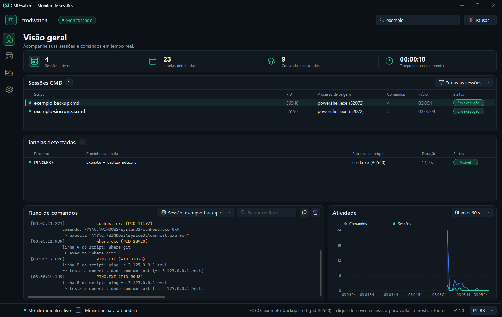
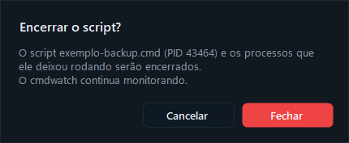
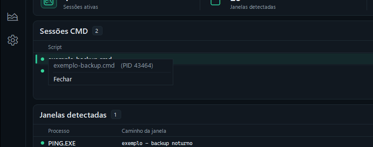
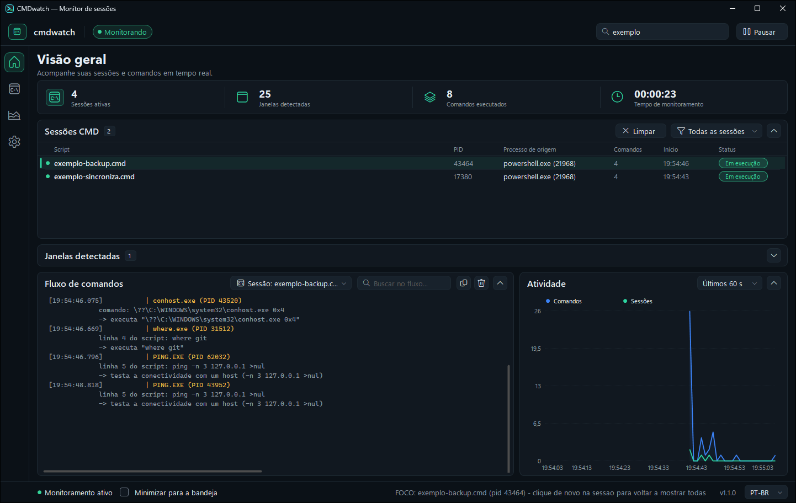
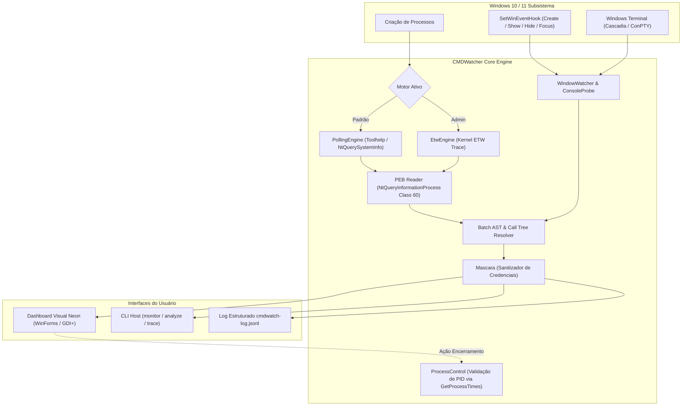

<div align="center">

# ⚡ CMDWatcher (cmdwatch)

**Monitor de execução em tempo real e rastreador de janelas e scripts `.cmd`/`.bat` para Windows 10/11**

[](https://microsoft.com/windows)
[-512BD4.svg?style=flat&logo=dotnet)](https://dotnet.microsoft.com)
[](https://docs.microsoft.com/dotnet/csharp/)
[%20%7C%20Portátil-success.svg?style=flat)](https://github.com/dellanio/cmdwatch/releases)
[](https://github.com/dellanio/cmdwatch)
[](LICENSE)

*Identifique janelas que piscam na tela, descubra o processo autor exato por trás de cada console e monitore execuções de agentes de IA em segundo plano.*

[English (README.md)](README.md)

</div>

---

## 📸 Capturas de Tela & Interface

<div align="center">
  <table>
    <tr>
      <td align="center"><b>Painel Gráfico em Tempo Real (Tema Escuro / Neon)</b></td>
      <td align="center"><b>Encerramento Seguro de Processos com Confirmação</b></td>
    </tr>
    <tr>
      <td align="center">
        
      </td>
      <td align="center">
        
      </td>
    </tr>
    <tr>
      <td align="center"><b>Menu de Contexto em Sessões e Janelas</b></td>
      <td align="center"><b>Cartões Recolhíveis e Layout Adaptativo</b></td>
    </tr>
    <tr>
      <td align="center">
        
      </td>
      <td align="center">
        
      </td>
    </tr>
  </table>
</div>

---

## ⚡ O Problema

Com o uso intensivo de **agentes autônomos de IA, ferramentas de automação e tarefas em segundo plano**, dezenas de scripts são disparados na máquina do desenvolvedor. Com o tempo:
- Terminais e janelas de CMD surgem do nada e roubam o foco durante a digitação;
- Scripts ocultos executam em background consumindo CPU e memória;
- O Gerenciador de Tarefas do Windows mostra apenas `cmd.exe` genéricos, tornando impossível saber **quem chamou** o script (se foi a IA, o VS Code, uma tarefa agendada ou o próprio Windows).

---

## 💡 A Solução: CMDWatcher

O **CMDWatcher** (`cmdwatch`) é um monitor leve e sem dependências para Windows 10/11 que responde em tempo real a quatro perguntas fundamentais:

1. **Qual `.cmd`/`.bat` foi executado?** O caminho exato do script e seus argumentos.
2. **Quem chamou?** A cadeia completa de ancestrais (pai, avô... até a raiz).
3. **O que ele está fazendo agora?** Qual comando interno roda na linha exata do script (inclusive dentro de rotinas `call` encadeadas), com explicação em linguagem humana.
4. **Que janela abriu e quem está por trás dela?** O processo autor real, duração em tela, histórico de foco e estado de visibilidade.

> **Auditoria Neutra:** O cmdwatch não rotula arbitrariamente o que é "bom" ou "ruim", nem se o processo é "IA". Ele entrega as **evidências técnicas irrefutáveis** para você tomar o controle.

| Cadeia Apresentada pelo cmdwatch | Interpretação Real |
|---|---|
| `node.exe` → `python.exe script_pai.py` → `git.exe` | Criado pelo seu agente de IA / extensão Node.js |
| `svchost.exe` → `cmd.exe /c higiene.cmd` | Disparado pelo **Agendador de Tarefas** do Windows |

---

## 🚀 Recursos Principais

- 📦 **Executável Único & Portátil:** ~580 KB compilado em C# (.NET Framework 4.8 já embutido no Windows). Sem instalador, sem DLLs e sem runtime extra.
- 🛡️ **Zero Elevação Obrigatória:** Lê processos e linhas de comando diretamente do PEB (`NtQueryInformationProcess`) sem requerer privilégios de Administrador.
- 🔍 **Descoberta do Autor do Console (ConPTY / Cascadia):** No Windows Terminal, associa automaticamente as janelas `CASCADIA_HOSTING_WINDOW_CLASS` à sua respectiva `PseudoConsoleWindow`, identificando o processo autor de verdade em vez do hospedeiro da UI.
- ⚡ **Motor Duplo (Polling & ETW Kernel):**
  - *Modo Padrão:* Polling adaptativo rápido (Toolhelp32 / `SystemProcessInformation`).
  - *Modo ETW (Kernel Trace):* Com privilégio de Administrador, escuta eventos em tempo real do kernel do Windows sem perder scripts ultracurtos (~25 ms).
- 🔒 **Máscara Automática de Segredos:** Sanitiza tokens, senhas, chaves de API, cabeçalhos `Bearer` e credenciais AWS antes de gravar em disco ou renderizar na tela.
- 🛑 **Encerramento Seguro contra Colisão de PID:** Permite encerrar scripts e árvores de processos pela UI com verificação rigorosa de data/hora de criação do PID (`GetProcessTimes`), impedindo matar processos reciclados.
- 🎨 **Interface Neon Customizada:** Construída em GDI+ puro sem frameworks pesados, com suporte a tema escuro/claro, busca em tempo real, ordenação de colunas e minimização para a Área de Notificação (Tray).

---

## 🏗️ Arquitetura & Fluxo de Dados



- **Linguagem:** C# (.NET Framework 4.8)
- **UI Toolkit:** Windows Forms com renderização sob demanda GDI+ (Dark / Light)
- **APIs Nativas:** `kernel32.dll`, `user32.dll`, `ntdll.dll` (`NtQueryInformationProcess`), `advapi32.dll` (ETW)
- **Build System:** Script autônomo PowerShell (`build.ps1`) com compilador Roslyn embutido

---

## 📦 Download & Uso Rápido

Baixe o executável pronto para uso:

**[⬇ Baixar cmdwatch v1.1.0 — cmdwatch.exe](https://github.com/dellanio/cmdwatch/releases/latest/download/cmdwatch.exe)**

### Abrir o Painel Gráfico
Dê **duplo clique** no `cmdwatch.exe` ou execute via terminal:

```powershell
cmdwatch.exe
```

### Modos de Linha de Comando (CLI)

```powershell
# Monitora o sistema continuamente e exibe no terminal
cmdwatch.exe monitor

# Saída direta em JSONL para integração com outras ferramentas
cmdwatch.exe monitor --json

# Análise estática de um script (explica comandos sem executá-lo)
cmdwatch.exe analyze script.cmd

# Executa o script passo a passo e captura a sequência exata de comandos
cmdwatch.exe trace script.cmd
```

#### Opções do Monitor:
| Parâmetro | Descrição |
|---|---|
| `--log <arquivo>` | Caminho do arquivo JSONL de saída (padrão: `cmdwatch-log.jsonl`) |
| `--engine <auto\|polling\|wmi\|etw>` | Seleciona o motor de captura (padrão: `auto`) |
| `--interval <ms>` | Intervalo de amostragem parado (padrão: 500 ms) |
| `--fast-interval <ms>` | Intervalo acelerado durante execução de scripts (padrão: 50 ms) |
| `--filter <texto>` | Filtra apenas `.cmd` cujo caminho contenha o termo |
| `--no-windows` | Desativa a observação de janelas da tela |
| `--no-mask` | Desativa a máscara de dados confidenciais |

---

## ⚙️ Motores de Captura

| Motor | Permissão | Cenário Ideal | Detalhes Técnicos |
|---|:---:|---|---|
| **polling** *(padrão)* | Usuário Comum | Uso diário geral | Consulta snapshots de processos pelo `CreateToolhelp32Snapshot` e `SystemProcessInformation`. Intervalo dinâmico de 500 ms (repouso) e 50 ms (atividade). |
| **etw** | Administrador | Scripts ultracurtos (< 50 ms) | Cria uma sessão dedicada no Event Tracing for Windows (`CMDWatcher-Processos`). O kernel entrega a linha de comando direto no payload do evento, sem perdas. |
| **wmi** | Administrador | Diagnóstico alternativo | Escuta `Win32_ProcessStartTrace`. |

---

## 🔒 Modelo de Segurança & Privacidade

- **Apenas Leitura do Sistema:** O cmdwatch não injeta DLLs, não instala drivers de kernel e não bloqueia a execução do Windows.
- **Proteção Ativa de Credenciais:** As linhas de comando passam pelo sanitizador regex de `Mascara.cs` antes de serem exibidas ou salvas em disco. Flags sensíveis como `--password`, `--token`, `Authorization: Bearer`, URLs com credenciais e chaves AWS têm seu valor substituído por `***`.
- **Prevenção de Encerramento Acidental (PID Reuse):** Ao clicar em "Encerrar", o cmdwatch compara a data e hora de criação do processo alvo (`GetProcessTimes`) com o instante em que foi detectado. Se o processo já morreu e o Windows reaproveitou o PID, nada é encerrado.
- **100% Local & Sem Telemetria:** Nenhuma informação sai da sua máquina. Não há conexões de rede ou chamadas de analítica.

---

## 🛠️ Compilação e Testes

### Compilando a partir do código-fonte:
O repositório inclui o script autônomo `build.ps1`, que baixa o compilador Roslyn moderno e compila o binário otimizado:

```powershell
git clone https://github.com/dellanio/cmdwatch.git
cd cmdwatch

# Compilar cmdwatch.exe para a pasta out/
.\build.ps1
```

### Executando a Bateria de Testes:
Os scripts na pasta `tools/` validam regressões e comportamentos reais de baixo nível:

```powershell
# Executa testes funcionais dos defeitos corrigidos (D1 a D5)
powershell -ExecutionPolicy Bypass -File .\tools\test-defeitos.ps1

# Valida cadeia de ancestrais e tooltip na interface
powershell -ExecutionPolicy Bypass -File .\tools\test-cadeia-janelas.ps1

# Testa encerramento seguro pela tabela de janelas
powershell -ExecutionPolicy Bypass -File .\tools\test-encerrar-janela.ps1
```

---

## 📄 Licença

Distribuído sob a licença **MIT**. Consulte o arquivo [LICENSE](LICENSE) para mais detalhes.
